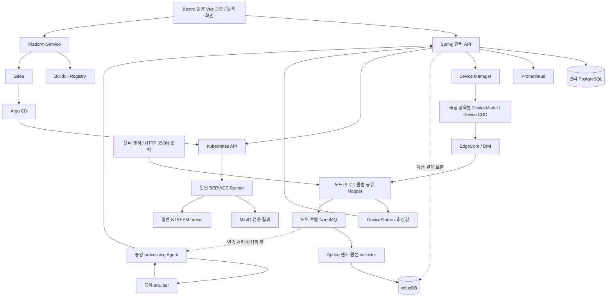

# 아키텍처

EdgeAI의 Spring 관리 API와 Kestra 원본 Vue 콘솔은 센서 수집, 중앙 연속 계산, 일반 SERVICE 실행을 연결합니다. 센서 설정·최신 관측의 원본은 KubeEdge CRD이며, 관리 등록·불변 버전·실행 이력은 PostgreSQL에 저장합니다. 구형 VD supervisor 경로는 종료됐습니다.

## 전체 구조

연속 처리 flag는 기본 false입니다. 중앙 Agent·qualified 입력·history 배포와 실제 수용 이후에만 점선 경로를 활성화합니다. eKuiper Pod 설치와 가상 센서의 실제 계산 실행은 다릅니다. 센서용 NanoMQ와 일반 STREAM broker는 다른 용도입니다.

센서 원본 collector와 InfluxDB 원본 저장·이력 조회는 연속 계산 flag와 별도로 동작합니다. 원본 collector·저장소 연결이 준비되면 위의 실선 경로로 센서 데이터를 보관합니다.

## 관리·관측·실행 경계

| 경계 | 책임 | 완료 판단 |
|---|---|---|
| 센서 관리 | 측정 항목별 CRD와 공유 Mapper 설정 | 저장된 설정과 실제 연결 상태 |
| 관측 | Kubernetes·Prometheus·DeviceStatus의 원본 값 조회 | 원본 시각·heartbeat·조회 성공 |
| 연속 가상 센서 | 입력 선택·계산 설정·공유 엔진 조정·출력별 결과 | 엔진 lease·generation·입력 신선도·결과/저장 상태 |
| Spring 실행 | SERVICE DAG의 Run·Task·Attempt·Result | 검증된 Task Result |
| DDS 배포 | 이미지 빌드와 GitOps 반영 | Git·Argo·실제 Pod와 서비스 |

브라우저는 고정된 서버 측 프록시를 사용합니다. Kubernetes·Prometheus·Mapper에 대한 자격 증명과 접근은 서버·adapter 경계에서 관리합니다. 접근 조건은 [요청 보호](../reference/access.md)를 확인합니다.

## 리소스와 저장

센서 Device/DeviceStatus는 측정 항목마다 분리합니다. 여러 센서가 같은 물리 연결과 Mapper를 공유할 수 있습니다. 센서 등록과 연속 VD 등록은 별개이며, VD 하나의 여러 출력은 결과 행으로 분리하고 출력 CRD를 만들지 않습니다.

연속 VD는 내부 v3 설정과 원본 연결 revision을 보존하며 VD마다 SERVICE·supervisor·Pod를 만들지 않습니다. 입력 프로토콜은 Mapper가 처리하고 중앙 Agent/eKuiper는 공통 관측 계약을 소비합니다. 엔진의 세대·lease·결과 신원과 저장 누락을 추적합니다.

Mapper의 원본 MQTT 데이터는 원본 collector가 InfluxDB에 저장하며 UID·항목별 이력 API로 조회합니다. 연속 계산 결과의 최신값·보관 이력과 센서 원본은 별도 측정 계열이며 결과 저장 정책·대기열과 원본 수집의 보장 범위도 구분합니다. 기존 `device` BATCH 입력은 Run 접수 때 최신값을 고정합니다. 명시적 `WORKFLOW_DATA` 입력 SERVICE는 검증된 센서 원본 archive 또는 연속 VD의 current VALID output을1초마다 읽고 Task→Task STREAM으로 전달합니다. 소스 cursor·상태와 emission은 같은 EXTERNAL journal commit에 확정하며 기존 체크포인트·복원·공동 종료 장벽을 재사용합니다. CRD 이름을 UUID DeviceSession으로 바꾸지 않으며 sensor NanoMQ와 Task STREAM broker의 역할을 구분합니다. 중간 모든 관측의 전달은 보장하지 않습니다.

SERVICE·Workflow 버전은 불변이고 재시도·전환은 같은 Task의 새 Attempt입니다. Runner 파일 결과는 고정 객체 버전과 실제 내용 검증 뒤 확정합니다. Spring DAG와 DDS 배포는 별도 경로이며 Git 저장 성공을 Run/Result 완료로 바꾸지 않습니다.

## 백엔드 패키지 구조

| 모듈·패키지 | 책임 |
|---|---|
| `backend/domain` | 순수 모델·규칙·저장소와 외부 기능 인터페이스 |
| `backend/adapters` | PostgreSQL·Kubernetes/KubeEdge·Prometheus 등 외부 구현 |
| `backend/app/controller` | HTTP 입력·응답 |
| `backend/app/service` | 트랜잭션과 유스케이스 |
| `backend/app/dto` | 요청·응답 모델 |
| `backend/app/config` | Spring 조립·보안·worker 구성 |
| `backend/app/exception`, `support` | 오류 변환·JSON·검증 |

실제 앱 패키지는 `io.edgeai.app` 아래에 있습니다. domain은 Kubernetes·S3·MQTT를 직접 호출하지 않습니다. 설정과 적용된 Flyway migration은 `backend/app/src/main/resources`에 있으며 기존 migration은 수정하지 않습니다.

## 더 읽기

- [리소스 모델](../concepts/resources.md), [원 설계 대조](../reference/design-alignment.md)
- [센서 등록](../guides/sensor-registration.md), [연속 가상 센서](../guides/vd-processing.md), [Mapper 구조](../../deploy/kubeedge/README.md)
- [API 참고](../reference/api.md), [지원 범위](../reference/support.md), [운영과 복구](../operations/overview.md)
- [구형 VD 종료·후속 계약](../adr/0115-retire-legacy-virtual-devices.md), [단계별 구현 계약](implementation-contract.md)
