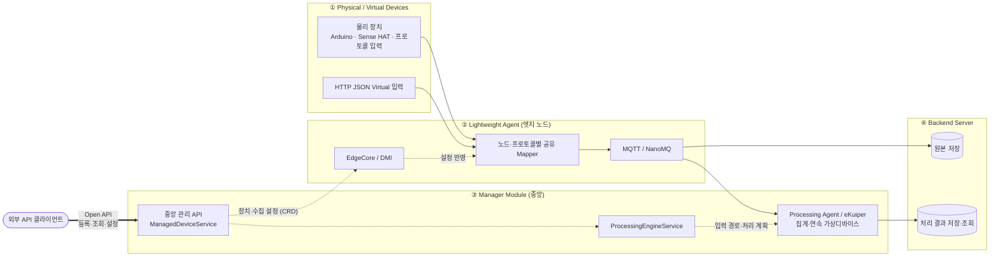
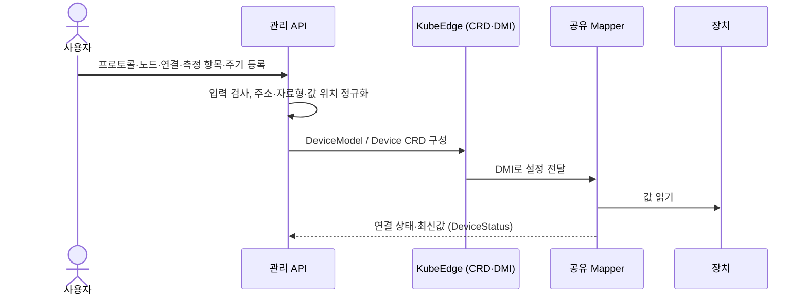
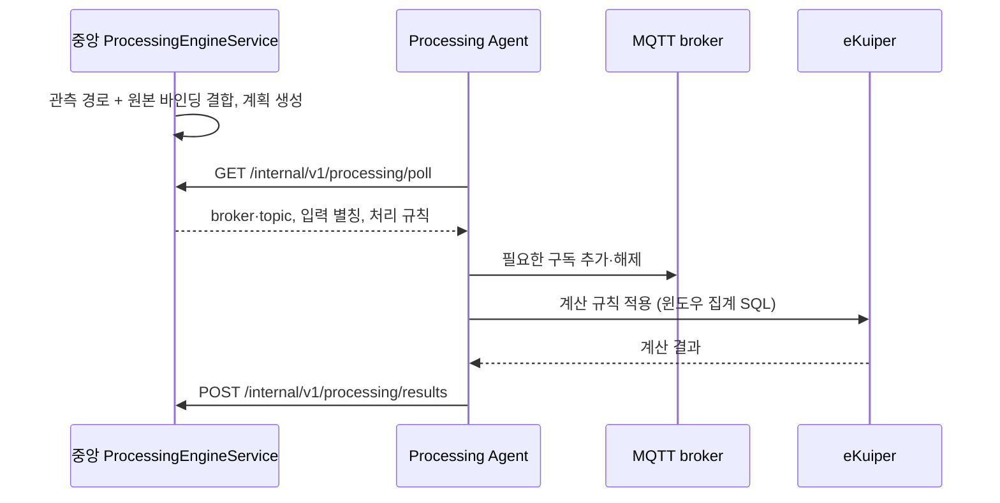

# 2-3. 실시간 데이터 전송 지원 개방형 미들웨어 기술 개발

물리·가상 디바이스를 등록·관리하고, 이기종 장치의 데이터를 수집·전송·저장·처리하는 계층 기반 개방형 미들웨어 핵심 기능을 구현하였다. 이 문서는 2차년도 목표별 수행 내용과 구현 방법을 소스 코드에 연결하는 기술 설명서다.

> **작성 기준:** 2026-10-29 · 소스 확인 기준 `main`의 `b2a399458a3da6946b4fd48ad68afbf8c67c2110`
> 기존 기술메모의 시험 근거를 재사용하며, 문서 작성만으로 기능 시험이나 실장비 수용시험을 새로 수행한 것으로 표시하지 않는다.

## 한눈에 보기

| 2차년도 목표 | 핵심 결과 | 상세 |
|---|---|---|
| ① 디바이스 등록·탐색·메타데이터 전송 | 등록 → CRD 구성 → Mapper 수집, 등록 장치·데이터 원본 조회, 관측 식별정보 전달 | [3장](#3-디바이스-등록탐색메타데이터-전송-구현) |
| ② 계층 관리자·기본 데이터 경로 설정 | 중앙 관리 모듈 ↔ 노드별 경량 에이전트, 등록 정보 → 수집·MQTT 전송 → 저장·연속 처리 | [4장](#4-계층-관리자와-기본-데이터-경로-설정-구현) |
| ③ 개방형 API·이기종 연동 | HTTP/JSON·OpenAPI, 7종 입력(Modbus TCP·OPC-UA·MQTT·HTTP JSON·Serial JSON·Sense HAT·RTSP) | [5장](#5-개방형-api와-이기종-연동-구현) |

**포함하지 않는 범위:** 미등록 장치의 범용 자동 발견, 엣지 노드별 독립 통계 집계, 다단계 경로 편집, 전 제조사·인증 방식 호환, 무손실·지연 상한 보장 ([6장](#6-확보한-근거와-성과-범위)).

## 목차

1. [목표와 수행 내용](#1-목표와-수행-내용)
2. [계층 구조와 구성도 대응](#2-계층-구조와-구성도-대응)
3. [디바이스 등록·탐색·메타데이터 전송 구현](#3-디바이스-등록탐색메타데이터-전송-구현)
4. [계층 관리자와 기본 데이터 경로 설정 구현](#4-계층-관리자와-기본-데이터-경로-설정-구현)
5. [개방형 API와 이기종 연동 구현](#5-개방형-api와-이기종-연동-구현)
6. [확보한 근거와 성과 범위](#6-확보한-근거와-성과-범위)
7. [수행 실적 요약문](#7-수행-실적-요약문)

---

## 1. 목표와 수행 내용

목표는 **물리·가상 디바이스 환경에서 미들웨어 핵심 기술 개발**이다.

| 2차년도 목표 | 수행 내용 | 구현 방법 |
|---|---|---|
| 디바이스 등록·탐색·메타데이터 전송 기능 개발 | 물리·가상 디바이스 등록, 등록된 디바이스 조회·탐색, 측정 규격과 원본 식별정보 전달 | 관리 API, KubeEdge DeviceModel·Device CRD, 디바이스·데이터 소스 목록, 공통 관측 메시지 |
| 계층 기반 관리자 모듈 설계 및 기본 데이터 경로 설정 기능 구현 | 중앙 관리 모듈과 노드별 경량 에이전트의 역할 분리, 장치에서 저장·처리 서비스까지 기본 전달 경로 설정 | 중앙 설정 생성 → KubeEdge/DMI 설정 전달 → Mapper 수집·MQTT 발행 → 원본 저장·중앙 연속 처리 |
| 개방형 API 연동 구조 구현 및 이기종 디바이스 연동 기술 개발 | 디바이스 관리·조회·연결 시험 API와 프로토콜별 드라이버, 서로 다른 입력의 공통 관리·처리 경로 연결 | HTTP/JSON API·OpenAPI 계약, Modbus TCP·OPC-UA·MQTT·HTTP JSON·Serial JSON·Sense HAT·RTSP 연동 |

> **용어 정의**
> - **탐색:** 등록된 디바이스와 사용 가능한 데이터 원본의 조회·선택
> - **경량 에이전트의 집계:** 여러 장치·측정 항목의 수집·취합
> - **통계 집계:** 이동평균·최솟값·최댓값 등 — 중앙 eKuiper에서 수행

## 2. 계층 구조와 구성도 대응

설계 구성도의 `Physical Devices → Lightweight Agent Prototype → Manager Module → Backend Server`를 아래 역할로 구현하였다.

**범례:** 실선 = 데이터 전달 · 점선 = 설정·제어 · 굵은 선 = 외부 API 연동

- Manager Module과 Backend Server는 **논리적 역할 구분**이며, 각각 별도 서버나 프로세스라는 의미는 아니다.
- Open API는 관리·조회 연동 경로이며, 임의 센서 값을 받는 범용 HTTP 수집 endpoint가 아니다.

| 구성도 요소 | 실제 구현 | 담당 기능 |
|---|---|---|
| **Physical Devices** | Arduino·Sense HAT 등 물리 장치, 프로토콜별 입력 장치 | 측정값 또는 영상 제공 |
| **가상 디바이스 환경** | HTTP JSON 기반 Virtual 입력, 연속 가상디바이스 | 소프트웨어 원본 입력, 센서 조합·계산 결과 제공 |
| **Lightweight Agent Prototype** | 노드·프로토콜별 공유 Mapper, EdgeCore/DMI, 노드 MQTT/NanoMQ | 여러 장치 수집·취합, 설정된 경로로 전송, 장치 조회·연결 시험 API |
| **Manager Module** | 중앙 관리 API, ManagedDeviceService, ProcessingEngineService, Processing Agent·eKuiper | 장치 설정·상태 관리, 입력 경로와 처리 계획 생성, 중앙 집계·연속 처리 |
| **Backend Server** | 원본 collector, 이력·메타데이터 저장 및 조회 서비스 | 원본과 처리 결과의 저장·조회, 서비스 입력 연계 |
| **Open API** | HTTP/JSON 관리·조회 API와 OpenAPI 계약 | 외부 클라이언트의 등록·조회·설정 연동 |

---

## 3. 디바이스 등록·탐색·메타데이터 전송 구현

### 3.1 등록과 측정 항목 관리

- 측정 항목별로 Device를 관리하고, 같은 노드·프로토콜의 Mapper를 공유한다.
- 항목 추가·수정·해제 시 다른 측정 항목을 보존하며, `resourceVersion`으로 동시 변경 충돌을 검사한다.
- 가상디바이스는 별도 등록 API에서 원본 센서와 계산·출력 설정을 연결한다.

> **구현 근거:** [ManagedDeviceController](../../backend/app/src/main/java/io/edgeai/app/controller/ManagedDeviceController.java) · [ManagedDeviceService](../../backend/app/src/main/java/io/edgeai/app/service/ManagedDeviceService.java) · [DeviceProfileCompiler](../../backend/app/src/main/java/io/edgeai/app/support/DeviceProfileCompiler.java) · [ContinuousDeviceController](../../backend/app/src/main/java/io/edgeai/app/controller/ContinuousDeviceController.java)

### 3.2 등록된 디바이스와 데이터 원본 탐색

디바이스 목록·상세, 저장 규격, 지원 프로토콜을 조회하고, 워크플로 데이터 소스 목록에서 센서·가상디바이스 원본을 입력으로 선택할 수 있다. 등록된 장치의 **존재**와 실제 **연결·수집 상태**는 구분한다.

| 탐색 대상 | 대표 API | 용도 |
|---|---|---|
| 등록 센서 | `GET /api/devices` `GET /api/devices/{id}` | 장치·측정 항목·연결 상태 조회 |
| 저장 규격·프로토콜 | `GET /api/device-profiles` `GET /api/protocols` | 재사용 규격과 연동 방식 확인 |
| 가상디바이스 | `GET /api/v1/virtual-devices` | 등록된 가상디바이스 조회 |
| 처리 입력 후보 | `GET /api/v1/virtual-devices/continuous-catalog` | 연속 처리 등록에 사용할 입력·규격 조회 |
| 워크플로 원본 | `GET /api/v1/workflow-data-sources` | 센서·가상디바이스 입력 선택 |

> **구현 근거:** [WorkflowDataSourceController](../../backend/app/src/main/java/io/edgeai/app/controller/WorkflowDataSourceController.java) · [WorkflowDataInputService](../../backend/app/src/main/java/io/edgeai/app/service/WorkflowDataInputService.java) · [관리 API 계약](../../contracts/openapi/platform-api.yaml)

### 3.3 메타데이터와 관측 식별정보

| 구분 | 포함 정보 |
|---|---|
| 등록 규격 (DeviceModel) | 측정 항목 이름, 자료형, 단위, 프로토콜별 값 위치 |
| 데이터 전달 | 장치·측정 항목 식별정보, 관측 시각 |
| 검증된 관측 형식 | 설정 digest, source generation, session, sequence |

- 같은 이름으로 재등록하거나 Mapper가 재시작해도 원본과 관측 순서를 구분할 수 있다.
- **최신 상태**는 DMI·DeviceStatus로, **원본 데이터**는 MQTT 경로로 전달하므로 두 경로를 각각 확인할 수 있다.

> **구현 근거:** [Mapper 수집·발행](../../mappers/internal/runtime/panel.go) · [관측 경로 해석](../../backend/app/src/main/java/io/edgeai/app/support/ObservationRoute.java) · [센서 원본 저장](../../backend/app/src/main/java/io/edgeai/app/service/SensorArchiveCollector.java)

---

## 4. 계층 관리자와 기본 데이터 경로 설정 구현

### 4.1 중앙에서 설정하고 하위 에이전트에 적용

**등록 정보 → 실행 설정 → 해당 노드의 수집·전송 동작**을 연결하였다.

1. 중앙 관리 모듈이 등록 정보를 Device CRD로 변환하며 대상 노드, 수집 주기, 프로토콜·값 위치, MQTT `pushMethod`를 설정한다.
2. MQTT 출력 주소는 관리 서비스 설정에서 받고, 기본 토픽은 장치·측정 항목으로 생성한다.
3. Mapper는 설정된 broker·topic·QoS로 실제 데이터를 발행한다.
4. 변경 설정은 DMI callback으로 반영하고, 주기적 설정 동기화로 callback 누락이나 EdgeCore 재시작에 대응한다.

| 경로 설정 요소 | 설정·해석 방법 | 적용 위치 |
|---|---|---|
| 수집 노드 | 등록 요청의 `targetNode` → CRD `nodeName` | 공유 Mapper 배치·장치 선택 |
| 장치 연결 | host·port 또는 로컬 장치 경로, 프로토콜 설정 | 프로토콜 드라이버 |
| 측정값 위치 | register, NodeId, topic·JSON 경로 등 | 측정 항목 읽기 |
| 출력 경로 | 관리 서비스 broker 설정 + 장치·항목별 생성 토픽 | Mapper MQTT 발행 |
| 중앙 접근 broker | 장치 설정·노드 정보 및 노드별 override | 원본 수집·연속 처리 구독 |
| 처리 입력 연결 | 가상디바이스 원본 바인딩 + 관측 경로 | Processing Agent 입력 계획 |

> **구현 근거:** [DeviceProfileCompiler](../../backend/app/src/main/java/io/edgeai/app/support/DeviceProfileCompiler.java) · [ObservationRoute](../../backend/app/src/main/java/io/edgeai/app/support/ObservationRoute.java) · [Mapper 시작·설정 동기화](../../mappers/cmd/mapper/main.go)

### 4.2 중앙 처리 계획과 구독 경로 관리

- 중앙은 장치 UID·규격·측정 항목을 확인한 뒤 계획을 생성한다.
- 이동평균·최솟값·최댓값은 규칙 compiler가 윈도우 집계 SQL로 변환한다.

> **구현 근거:** [중앙 계획 생성](../../backend/app/src/main/java/io/edgeai/app/service/ProcessingEngineService.java) · [Agent 계획 수신·적용](../../mappers/internal/processing/poll.go) · [MQTT 구독 갱신](../../mappers/internal/processing/mqtt.go) · [집계 규칙 생성](../../backend/app/src/main/java/io/edgeai/app/support/ContinuousRuleCompiler.java)

### 4.3 경량 에이전트의 API

| Mapper endpoint | 용도 |
|---|---|
| `GET /devices` | 노드의 장치 조회 |
| `GET /capabilities` | 지원 기능 조회 |
| `POST /connections/test` | 실제 수집 노드에서 측정 항목을 읽어 연결 확인 |
| RTSP preview | 영상 연결 확인 |

중앙 관리 서비스는 대상 노드의 Mapper에 연결 시험을 요청하므로, 중앙 서버의 단순 네트워크 접근이 아니라 **실제 수집 노드에서** 연결을 확인한다. 이 endpoint는 경량 에이전트의 내부 연동 기능이며, 중앙 공개 관리 API와 접근 범위가 같다는 의미는 아니다.

> **구현 근거:** [Mapper HTTP endpoint](../../mappers/cmd/mapper/main.go) · [중앙의 연결 시험 호출](../../backend/app/src/main/java/io/edgeai/app/service/ManagedDeviceService.java)

---

## 5. 개방형 API와 이기종 연동 구현

HTTP/JSON API로 등록·조회·설정·연결 시험을 제공하고, OpenAPI 계약으로 요청·응답 구조를 정의하였다. 프로토콜별 차이는 **Mapper 드라이버와 설정 compiler**에서 처리하고, 상위 관리·저장·연속 처리는 공통 장치·측정 항목 정보를 사용한다.

| 프로토콜 | 구현 방식 | 검증 근거·적용 범위 | 검증 환경 |
|---|---|---|---|
| Modbus TCP | Unit ID·register·함수·바이트 순서를 읽기 설정으로 변환 | TCP 시험 장치 기반 연동 | 시험 장치 |
| OPC-UA | endpoint·NodeId로 항목 조회 | Anonymous·SecurityMode None | 시험 서버 |
| MQTT 입력 | 지정 broker·정확한 topic의 JSON 값 추출 | wildcard·자체 출력 topic 제한 | 시험 발행자 |
| HTTP JSON Virtual | HTTP endpoint 응답에서 지정 항목 추출 | 소프트웨어 원본 연동 | 시험 Virtual Runtime |
| Serial JSON | 직렬 장치에서 줄별 JSON을 읽고 항목 매핑 | Arduino 수집 | **실장비** |
| Sense HAT v1 | Raspberry Pi I²C 장치에서 보드 항목 수집 | Sense HAT 수집 | **실장비** |
| RTSP | 스트림 프레임 디코딩으로 연결 확인·JPEG preview | 영상 연동 | 데모 스트림 |

물리 센서 값을 조합·계산해 연속 가상디바이스 출력을 생성하고, 그 결과를 조회·이력 저장·워크플로 입력에 연결하였다. **HTTP Virtual 입력**(소프트웨어 원본)과 **연속 가상디바이스**(계산 결과)는 서로 다른 역할이다.

> **근거:** [이기종 센서 연동 기술메모](TM-01_이기종_센서_연동.md) · [가상디바이스 연속 처리 기술메모](TM-02_가상디바이스_연속_처리.md) · [Mapper 드라이버](../../mappers/internal/driver/) · [관리 API 계약](../../contracts/openapi/platform-api.yaml)

---

## 6. 확보한 근거와 성과 범위

| 확인 내용 | 근거 | 구분 |
|---|---|---|
| 등록·항목 수정·충돌 처리·상태 판정 | [ManagedDeviceServiceTest](../../backend/app/src/test/java/io/edgeai/app/service/ManagedDeviceServiceTest.java), TM-01 | 단위 시험·기존 기술메모 |
| 실제 보드 수집과 프로토콜 시험 연동 | [센서 등록 가이드](../guides/sensor-registration.md), [KubeEdge 연동 자료](../../deploy/kubeedge/README.md), TM-01 | 실장비와 시험 서버 구분 |
| 관측 메시지 발행·식별 | [관측 통합 시험](../../mappers/internal/runtime/observation_integration_test.go) | 실제 MQTT broker 사용 시험 코드 |
| 처리 계획·구독·윈도우 집계 | [처리 Agent 통합 시험](../../mappers/internal/processing/agent_integration_test.go), TM-02 | 통합 시험 코드·기존 수행 근거 |
| 원본 저장·중복 처리 | [원본 저장 기술메모](TM-03_센서_데이터_저장_안정화.md) | 기존 시험·운영 근거 |
| 전체 관측 feed의 API·콘솔 통합과 Runner 게시 | [진행 기록](../../PROGRESS.md), [ADR0118](../adr/0118-workflow-source-full-observation-feed.md) | 2026-10-22 배포 기록 (운영 전체 경로 수용과 구분) |

**자체 개발 성과**
- 프로토콜별 설정 검사·정규화
- CRD 구성과 공유 Mapper 관리
- 관측 메시지·식별정보 전달
- 기본 경로 생성·구독 적용
- 중앙 처리 계획·규칙 생성
- 관리 API·콘솔 연동

KubeEdge, NanoMQ, eKuiper 자체를 새로 개발한 것으로 표현하지 않는다.

**성과 범위:** 등록 장치 탐색, 중앙 제어와 하위 수집 계층, 기본 데이터 경로 설정, 지원 프로토콜 연동

**포함하지 않는 범위**
- 미등록 장치의 범용 자동 발견
- 각 엣지 노드에서의 독립 통계 집계
- 임의 목적지로의 다단계 경로 편집
- 모든 제조사 장비·인증 방식의 호환성
- 무손실·실시간 지연 상한 보장

---

## 7. 수행 실적 요약문

물리·가상 디바이스 환경에서 실시간 데이터 전송을 지원하기 위한 개방형 미들웨어 핵심 기능을 개발하였다. 디바이스 등록, 등록된 디바이스의 조회·탐색 및 메타데이터 전송 기능을 구현하고, 중앙 관리 모듈과 노드별 경량 에이전트로 구성되는 계층 구조를 설계·구현하였다. 대상 노드와 프로토콜별 수집 설정, MQTT 전송 경로 및 처리 입력 바인딩을 연결하여 디바이스에서 원본 저장·연속 처리 서비스까지 기본 데이터 경로를 설정하도록 하였다. 또한 HTTP/JSON 관리 API와 OpenAPI 연동 구조를 제공하고, 프로토콜별 Mapper를 통해 이기종 물리 장치와 소프트웨어 원본을 공통 관리·처리 경로에 연계하였다. Arduino·Sense HAT 실장비 및 프로토콜별 시험 환경에서 확보한 연동 근거를 바탕으로 원본 수집·저장과 중앙 집계·가상디바이스 연속 처리 기능을 구성하였다.
