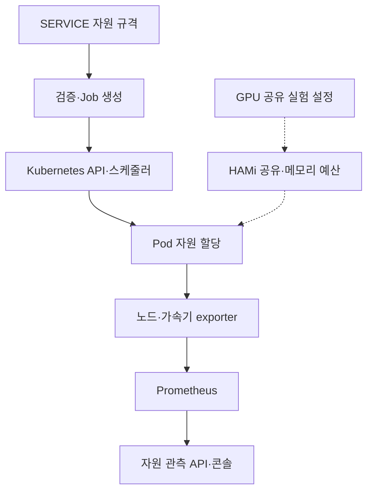

# 3-3. 가상 디바이스 성능 증강 기술

CPU·GPU·메모리·NPU를 서비스 실행에 사용할 논리 자원으로 정의하고, 자원 요구량을 Kubernetes 실행 설정으로 연결하는 인터페이스를 구현하였다. 자원 관측 API를 구축하고, GPU 공유 환경에서 논리 분할·메모리 제한·동시 실행·처리량·지연·간섭을 실장비로 측정하여 자원 가상화 기반 성능 증강 연구를 수행하였다.

작성 기준: 2026-10-29. 플랫폼 구현은 `main`의 `248edcc1774ffc82688cb271e5184bd073984b48`, GPU 공유 연구는 별도 실험 브랜치의 `1421f6fca1b0c155ebe39c2a6c34f07b147b6fad`를 기준으로 확인하였다. 이 문서는 구현과 기존 연구 결과를 연결하는 기술 설명서이며, 문서 작성 중 부하 시험을 새로 수행한 결과는 아니다.

## 1. 목표와 수행 내용

대상 목표는 **자원 가상화(Resource Virtualization) 기반 성능 증강 연구**이며, 다음 두 세부 항목에 대응한다.

| 2차년도 목표 | 수행 내용 | 확보한 결과 |
|---|---|---|
| CPU/GPU/메모리/NPU 등의 자원을 세분화 정의 및 논리 설계 | CPU·메모리의 수량 단위와 요청량·상한, GPU·NPU의 벤더별 확장 자원 키를 정의하고, 서비스 실행 규격과 노드 가용 자원 모델에 연결하였다. | 공통 자원 모델·검증 규칙·배치 제약 구현. GPU는 별도 실험에서 논리 공유 단위와 메모리·코어 예산을 구성 |
| 자원 가상화 인터페이스 설계 및 구축 | SERVICE Profile → 실행 규격 검증 → Kubernetes Job/Pod 자원 설정으로 이어지는 인터페이스와 자원 관측 API를 구현하였다. | CPU·메모리·가속기 요청의 실행 설정 전달, inventory·메트릭 조회, HAMi 기반 GPU 공유 실험 인터페이스 구축·측정 |

핵심 성과는 **자원 정의·실행 연동 인터페이스 구현과 GPU 가상화 성능 연구**다. GPU 공유 연구는 플랫폼의 일반 SERVICE 경로와 별도인 Kubernetes 실험 경로에서 수행하였다. 모든 GPU·NPU의 내부 연산 자원을 동일한 비율로 분할하거나, 분할 비율에 비례한 성능을 보장한 것은 아니다.

## 2. CPU·GPU·메모리·NPU의 논리 자원 정의

### 2.1 공통 자원 모델

서비스 실행 규격의 `resources.requests`와 `resources.limits`로 자원 요구량을 표현한다. CPU와 메모리는 필수이며, GPU·NPU는 device plugin이 제공하는 벤더 도메인 자원 키로 추가한다.

| 자원 | 정의·단위 | 구현 규칙 | 의미 |
|---|---|---|---|
| CPU | core 또는 millicore, 예: `1`, `500m` | 양수, 최대 소수 셋째 자리, request ≤ limit | CPU 스케줄링 요청량과 실행 상한 표현 |
| 메모리 | byte 또는 `Ki`·`Mi`·`Gi`·`Ti` | 양수 정수 단위, request ≤ limit | 메모리 요청량과 컨테이너 상한 표현 |
| 임시 저장 공간 | `ephemeral-storage`, 메모리와 같은 수량 표기 | 선택 항목, request ≤ limit | 실행 중 임시 저장 자원 표현 |
| GPU | 예: `nvidia.com/gpu`, `nvidia.com/gpu.shared` | 벤더 확장 자원은 양수 정수, request = limit | plugin이 광고하는 장치 또는 공유 슬롯 단위 |
| NPU | 예: `hailo.ai/h8`, `npu.intel.com/accel`, `mobilint.com/npu` | 벤더 확장 자원은 양수 정수, request = limit | 장치별 plugin의 할당 단위. NPU 내부 코어 분할과 구분 |
| GPU 논리 공유 실험 | `hami.io/vgpu`, `nvidia.com/gpumem`, `nvidia.com/gpucores` | HAMi 실험에서 공유 수·MiB 예산·논리 코어 비율을 설정 | 논리 비율과 실제 성능의 관계를 측정하는 연구 변수 |

`ResourceRequirements`는 잘못된 단위, 0·음수, 요청량이 상한을 초과하는 설정, 확장 자원의 소수 요청 등을 거절한다. CPU·메모리의 request와 limit이 모두 같으면 `Guaranteed`, 그렇지 않으면 `Burstable`로 QoS를 계산한다. 이 분류 자체가 처리량이나 응답시간을 보장하는 계약은 아니다.

근거: [ResourceRequirements](../../backend/domain/src/main/java/io/edgeai/domain/runtime/ResourceRequirements.java), [SERVICE 실행 JSON Schema](../../contracts/profiles/service-execution.schema.json), [실행 규격 검증 시험](../../backend/app/src/test/java/io/edgeai/app/support/ExecutionSpecTest.java).

### 2.2 물리 장착 정보·할당 가능량·실제 사용량의 분리

물리 장착 정보는 가속기 종류·벤더·모델로 표현하고, Kubernetes `status.allocatable`은 스케줄러에 노출된 자원 수량으로 표현한다. Prometheus 관측값은 사용률·메모리·온도·전력과 관측 시각으로 관리한다.

이 세 정보를 구분하여 공유 슬롯 두 개를 물리 GPU 두 대로 세거나, allocatable 총량을 현재 남은 자원으로 해석하지 않도록 하였다. 사용률이 수집되지 않은 NPU도 장착 정보가 확인되면 목록에 표시하며, 미수집·만료와 실제 사용률 0을 구분한다.

근거: [InfrastructureSource](../../backend/domain/src/main/java/io/edgeai/domain/node/InfrastructureSource.java), [NodeMetricsResponse](../../backend/app/src/main/java/io/edgeai/app/dto/NodeMetricsResponse.java), [자원 관측·콘솔 기술메모](TM-06_엣지_자원_관측과_운영_콘솔.md).

## 3. 자원 가상화 인터페이스 구현

### 3.1 서비스 정의에서 실제 실행 설정까지

1. SERVICE Profile에 이미지, 실행 명령, CPU·메모리·확장 자원 요구량과 실행 가능한 아키텍처를 정의한다.
2. 실행 시 `ServiceExecutionInput`이 규격을 해석하고, `ResourceRequirements`가 수량·요청량·상한을 검증한다.
3. `KubernetesJobCompiler`가 이를 Job의 컨테이너 `resources.requests/limits`에 반영한다.
4. 노드 선택 조건, required node affinity, toleration, runtime class를 함께 전달한다.
5. 실제 배치와 자원 할당은 Kubernetes 및 해당 device plugin이 담당한다.
6. 실행 중 Runner는 자신의 cgroup CPU·메모리 사용량과 상한을 읽어 관측 정보로 보고한다.

다음은 실행 규격의 **자원 부분 예시**다. 완전한 Profile 요청이나 실제 실행 결과가 아니다.

```json
{
  "resources": {
    "requests": {"cpu": "500m", "memory": "512Mi", "nvidia.com/gpu": "1"},
    "limits": {"cpu": "2", "memory": "2Gi", "nvidia.com/gpu": "1"}
  }
}
```

NPU도 동일한 확장 자원 구조로 표현하며, 실제 대상 노드가 광고하는 자원 키를 사용한다. 저장소의 GPU/NPU 시나리오 배포 명세에는 각각 `nvidia.com/gpu: 1`과 `hailo.ai/h8: 1`이 CPU·메모리 요구량과 함께 정의되어 있다. 명세 존재와 실제 모델 성능 검증은 별개다.

근거: [Profile API](../../backend/app/src/main/java/io/edgeai/app/controller/ProfileController.java), [ServiceExecutionInput](../../backend/app/src/main/java/io/edgeai/app/support/ServiceExecutionInput.java), [KubernetesJobCompiler](../../backend/adapters/src/main/java/io/edgeai/adapters/kubernetes/KubernetesJobCompiler.java), [Runner cgroup 관측](../../runner/edgeai_runner/telemetry.py), [GPU/NPU 배포 명세](../../deploy/kubernetes/components/scenario-runtimes/scenario-runtimes.yaml).

### 3.2 자원 관측과 성능 판단 인터페이스

| 인터페이스 | 제공 정보·역할 | 구현 |
|---|---|---|
| `POST /api/v1/profiles/SERVICE` | 자원 요구량을 포함한 불변 SERVICE 버전 등록 | ProfileController·ProfileService |
| `GET /api/v1/infrastructure` | 노드 상태·아키텍처·Kubernetes allocatable | InfrastructureController·KubernetesInfrastructureInventory |
| `GET /api/v1/node-metrics` | CPU·메모리·가속기 관측값, 장착 정보, 시각·신선도 | NodeMetricsController·PrometheusNodeMetrics |
| Runner telemetry | 실행 컨테이너의 CPU 사용·상한, 메모리 사용·상한, 선택적 지연 측정 | cgroup reader·내부 Runner API |
| 성능 프로파일·배치 미리보기 | 작업·노드별 계산·전송 실측값을 사용한 BATCH 배치 비교 | SchedulingProfileController·SchedulingService |

성능 프로파일은 계산·전송 시간의 측정값을 사용하는 배치 기능이다. 서비스별 최소·최대 자원을 보장하거나 실행 중 자원을 자동 증강하는 기능과는 구분한다.

근거: [노드 메트릭 가이드](../guides/node-metrics.md), [Prometheus 조회 구현](../../backend/adapters/src/main/java/io/edgeai/adapters/metrics/PrometheusNodeMetrics.java), [측정 기반 배치 가이드](../guides/operational-scheduling.md).

## 4. 제공 구성도와 현재 구현의 대응

제공 구성도는 Control Node의 API·HPA·복제 제어기와 Worker Node의 metrics server·Prometheus·모니터링 API·컨테이너 그룹을 연결한다. 현재 시스템에서는 자원 정의·실행 제어와 모니터링 경로가 구현되어 있으며, HPA 자동 확장 전체 흐름은 별도 범위다.

| 구성도 요소 | 현재 대응 | 확인 범위 |
|---|---|---|
| API Service | EdgeAI 관리 API, Kubernetes API 연동 | 자원 규격 등록·검증·Job 생성·자원 조회 |
| Container Group | 서비스별 Kubernetes Job/Pod, 운영 서비스 Deployment/Pod | 컨테이너별 CPU·메모리·가속기 요구량 전달 |
| Core System metrics / Metrics server | Kubernetes metrics-server와 `metrics.k8s.io` | 설치·Available 상태 확인. EdgeAI 자원 화면은 별도 Prometheus 경로 사용 |
| Prometheus / Cluster Monitoring API | exporter → Prometheus → EdgeAI node-metrics API → 콘솔 | 노드·가속기 지표 연결, 신선도·미수집 판정 |
| Service metrics | Runner cgroup telemetry·선택적 workload 지연, 실험의 요청 지연·처리량 | 실행 관측과 연구 측정. 모든 서비스의 HPA 입력으로 자동 연결된 상태는 아님 |
| HPA / Replication Controller / Change | 클러스터의 기존 HPA·Deployment 제어 기반 | EdgeAI 서비스에 대한 지표 기반 자동 replica 증감 구현·수용 근거와 구분 |

아래는 실제 구현된 주요 연결이다. 점선은 GPU 공유 **실험**의 별도 실행 경로이며, HPA 자동 확장 연결을 완료한 것으로 표시하지 않는다.



2026-10-29 22:24 KST 전후 읽기 전용 확인에서는 metrics-server 1/1, `metrics.k8s.io` Available을 확인하였다. HPA는 Istio·Knative용 5개이며 EdgeAI namespace의 HPA는 없었다. GPU·NPU plugin이 노출한 자원 키와 일부 Jetson 노드의 `nvidia.com/gpu.shared: 2`도 확인하였다. Jetson plugin 설정은 `timeSlicing`, `replicas: 2`, `renameByDefault: true`다. 이는 공유 슬롯 노출 근거이며 두 개의 물리 GPU나 메모리 격리·성능 보장 증거는 아니다. 이 상태 조회에서는 서비스 변경이나 부하 발생을 수행하지 않았다.

## 5. GPU 논리 분할과 성능 증강 연구

### 5.1 논리 자원 공유 인터페이스 구성

RTX 5080에서 HAMi v2.10.0을 이용해 GPU 공유 인터페이스를 구성하였다. 기존 NVIDIA device plugin의 `nvidia.com/gpu`와 구분하기 위해 공유 자원 이름을 `hami.io/vgpu`로 두고, 적용 노드와 webhook namespace를 제한하였다. `deviceSplitCount: 10`으로 공유 단위를 설정하고, Pod별 GPU 메모리와 논리 코어 예산을 지정하였다.

2026-10-28 실험에서는 GPU 하나에 **Pod 10개를 각각 메모리 1,536 MiB·논리 코어 10으로 배정**하고 같은 GPU UUID에서 동시 실행되는 것을 확인하였다. Pod 내부 메모리 총량은 1,536 MiB로 표시되었다. 논리 코어 10이라는 값은 측정 성능 10%를 의미하지 않는다.

근거: [10분할 연구 기록](https://github.com/dsa04156/edgeai/blob/1421f6fca1b0c155ebe39c2a6c34f07b147b6fad/experiments/hami-gpu-sharing-20261028/README.md), [HAMi 설정](https://github.com/dsa04156/edgeai/blob/1421f6fca1b0c155ebe39c2a6c34f07b147b6fad/experiments/hami-gpu-sharing-20261028/hami-values.yaml).

### 5.2 처리량·지연·간섭 측정 결과

| 연구 | 조건 | 확보한 결과·해석 |
|---|---|---|
| 10월 28일 동시 실행 연구 | Qwen2.5-0.5B, 고정 입력 70·출력 64토큰, 조건별 60초·1회 | 단독 합산 168.7 tok/s 대비 5개 Pod에서 307.8 tok/s. 다만 p95는 383.7 ms → 1,043.6 ms로 증가하여 처리량 증가와 지연 악화를 함께 확인 |
| 10월 28일 10분할 | 같은 GPU의 10개 Pod, 각각 1,536 MiB·논리 코어 10 | 합산 306.0 tok/s, p95 2,101.9 ms. 분할 개수 증가가 계속 처리량 증가로 이어지지 않음을 확인 |
| 10월 29일 부하·정책 연구 | Qwen2.5-1.5B·vLLM, 조건별 60초·3회, default/force 비교 | 총 부하 약 155 req/s 조건에서 단일 Pod 처리량 136.1 req/s 대비 두 공유 Pod 합산 약 149.8 req/s. 저·중부하에서는 처리량이 비슷하고 공유 Pod의 p95가 약 1.7~1.8배로 악화 |
| 메모리 상한 연구 | `gpumem=2048`인 Pod에서 단계적으로 메모리 할당 | 텐서 1,664 MiB 시 CUDA OOM, HAMi 로그의 2 GiB 예산 초과 확인. 같은 GPU의 비교 서버는 해당 구간 요청 실패·재시작 0건 |
| 간섭 연구 | 두 공유 Pod 중 상대 Pod의 부하 변화 | 자기 예산 안의 경쟁 부하에서도 피해 Pod의 p95가 약 3.3배로 증가. 논리 분할만으로 지연 격리를 보장할 수 없음을 확인 |

10월 29일 연구에서는 63회 측정과 OOM 시험을 수행했다. 기본 정책의 코어 예산은 단독 사용 시 엄격한 성능 상한으로 나타나지 않았고, `force` 정책은 처리량을 제한하지만 유휴 GPU 활용과 지연에서 손해가 발생했다. 따라서 **“분할하면 항상 빨라진다”가 아니라, 공유 조건별 처리량·지연·격리의 차이를 정량화한 연구 결과**로 해석한다.

근거: [부하·지연·간섭 연구 전체 기록](https://github.com/dsa04156/edgeai/blob/1421f6fca1b0c155ebe39c2a6c34f07b147b6fad/experiments/hami-gpu-sharing-load-20261029/README.md), [집계 결과](https://github.com/dsa04156/edgeai/blob/1421f6fca1b0c155ebe39c2a6c34f07b147b6fad/experiments/hami-gpu-sharing-load-20261029/results/summary.md), [원시 측정](https://github.com/dsa04156/edgeai/blob/1421f6fca1b0c155ebe39c2a6c34f07b147b6fad/experiments/hami-gpu-sharing-load-20261029/results/runs.jsonl), [실험 실행 코드](https://github.com/dsa04156/edgeai/blob/1421f6fca1b0c155ebe39c2a6c34f07b147b6fad/experiments/hami-gpu-sharing-load-20261029/scripts/run.py).

서로 다른 날짜의 실험은 모델·서빙 방식·반복 조건이 다르므로 수치를 같은 조건의 개선 전후로 비교하지 않는다. HAMi는 연구 종료 후 제거되었으며, 일반 서비스에 상시 제공되는 플랫폼 기능으로 배포 완료한 상태를 뜻하지 않는다.

## 6. 구현·연구 성과와 적용 범위

| 구분 | 정리 |
|---|---|
| 플랫폼 구현 | CPU·메모리·가속기 자원 모델, SERVICE 실행 규격, 수량 검증, Job/Pod 자원 요청 변환, 자원 inventory·메트릭 API |
| 실장비 연구 | HAMi GPU 논리 공유, 10개 Pod 동시 실행, 메모리 예산, 정책·부하별 처리량·지연·간섭·OOM 측정 |
| NPU 대응 | 벤더 확장 자원 키를 통한 장치 단위 정의·할당 인터페이스와 관측 정보 연결. 내부 코어·메모리의 비율 분할은 별도 |
| 추가 통합 범위 | HAMi 공유 설정의 일반 SERVICE API/UI 통합, EdgeAI 대상 HPA·서비스 메트릭 제어 루프, 서비스별 자원 범위 내 자동 증강 |
| 성능 해석 범위 | 특정 GPU·모델·부하 조건의 연구 결과. 모든 모델·가속기에서 성능 향상이나 지연 격리를 보장하지 않음 |

자체 개발 성과는 공통 자원 계약·검증·Job 변환, 자원 식별·메트릭 매핑·API·콘솔 연계 및 실험 구성·측정·분석이다. Kubernetes·Prometheus·벤더 device plugin·HAMi 자체를 새로 개발한 것으로 표현하지 않는다. 기존 eKuiper 가상디바이스는 센서 계산 결과 모델이며, GPU/NPU 자원 가상화와 같은 개념으로 사용하지 않는다.

기존 검증 근거는 [실행 규격 시험](../../backend/app/src/test/java/io/edgeai/app/support/ExecutionSpecTest.java), [인프라 자원 API 시험](../../backend/app/src/test/java/io/edgeai/app/controller/InfrastructureControllerTest.java), [Runner 관측 시험](../../runner/tests/test_telemetry.py), [자원 관측 기술메모](TM-06_엣지_자원_관측과_운영_콘솔.md) 및 위 GPU 연구 기록이다. 문서 작성 시에는 코드·기존 결과·현재 클러스터의 읽기 전용 상태를 대조하였다.

## 7. 수행 실적 요약문

자원 가상화 기반 성능 증강을 위해 CPU·GPU·메모리·NPU의 자원 종류와 할당 단위를 세분화하여 정의하고, 서비스별 자원 요청량·상한 및 실행 조건을 표현하는 논리 모델을 설계·구현하였다. SERVICE 실행 규격을 검증하여 Kubernetes Job/Pod 자원 설정으로 변환하는 인터페이스와 노드·가속기 자원 관측 API를 구축하였다. 또한 HAMi 기반 GPU 공유 실험 환경을 구성하여 단일 GPU의 10개 논리 할당과 동시 추론을 확인하고, 메모리 예산 및 부하·정책에 따른 처리량·지연·간섭을 측정하였다. 이를 통해 자원 공유에 따른 처리량 개선 가능성과 지연·격리의 한계를 정량적으로 분석하여 자원 가상화 기반 성능 증강 연구를 수행하였다.
