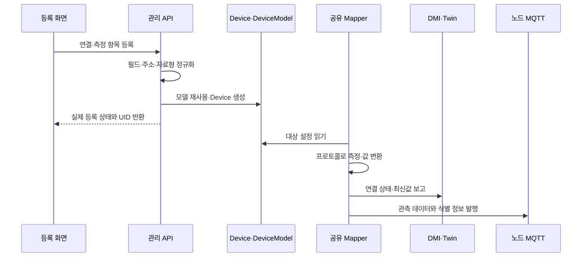

# KubeEdge 기반 이기종 센서 연동과 수집 관리

**기술메모 TM-01** · 2026-10-20

과제명: (기입) · 작성자: (기입) · 검토자: (기입)
기준 소스: `1170c1e88667ea22bba2b21844456c18821e0213`

## 개요

서로 다른 통신 방식을 쓰는 센서를 KubeEdge에 연결하고, 웹에서 측정 항목과 수집 상태를 관리한다. 하나의 보드에서 여러 값을 읽더라도 측정 항목은 따로 등록하며, 같은 연결과 Mapper를 공유한다. 장치 등록부터 연결 시험, 항목 수정, 최신값과 이력 조회까지 연결했다. [1][2]

개발한 부분은 프로토콜별 설정 검사, DeviceModel과 Device CRD 구성, 공유 Mapper 관리, DMI 상태 보고, MQTT 데이터 전달, 관리 API와 웹 화면이다. KubeEdge와 통신 라이브러리는 기존 소프트웨어를 사용한다.

| 항목 | 구성 |
|---|---|
| 지원 프로토콜 | Modbus TCP, OPC-UA, MQTT 입력, HTTP JSON Virtual, Serial JSON, Sense HAT v1, RTSP |
| 등록 단위 | 측정 항목별 Device와 Property 설정 |
| 실행 단위 | 노드·프로토콜별 공유 Mapper |
| 상태 확인 | DeviceStatus, DMI heartbeat, 실제 측정 시각 |
| 데이터 전달 | 최신 상태 보고와 별도의 MQTT 수집 경로 |

## 수집 구조

관리 API는 프로토콜, 대상 노드, 연결 정보, 측정 항목을 검사한 뒤 KubeEdge 설정에 반영한다. 인터페이스가 같으면 DeviceModel을 재사용하고, 같은 노드와 프로토콜의 장치는 공유 Mapper에 추가한다. 항목을 수정할 때는 다른 항목과 연결 설정을 유지한다. [1][2]

| 순서 | 담당 | 처리 내용 |
|---|---|---|
| 1 | 관리 API | 필수 입력, 자료형, 포트, 수집 간격, 항목 매핑 검사 |
| 2 | 장치 관리자 | DeviceModel과 Device CRD 생성 또는 재사용 |
| 3 | Mapper | 설정을 읽고 프로토콜 드라이버로 측정값 수집 |
| 4 | DMI | 연결 상태와 최신값 보고 |
| 5 | MQTT | 원본 데이터와 식별 정보 전달 |
| 6 | 관리 화면 | 연결 상태, 측정 시각, 값 표시 |

DMI와 Twin은 최신 상태를 보여주고, MQTT는 수집한 데이터를 원본 저장소와 연속 계산에 전달한다. 같은 값이 반복되면 Twin 갱신 시각이 바뀌지 않을 수 있다. 수집이 계속되는지는 heartbeat와 MQTT 수신도 함께 확인한다.

### 데이터 식별 정보

검증된 수집 데이터에는 UID, property, 수집 설정 식별자, source generation, session, sequence, 측정 시각을 유지한다. 이름이 같은 센서를 다시 등록해도 UID가 다르면 이력을 구분한다. 이전 DataModel 형식은 수집 설정을 검증할 수 없어 ‘설정 미검증’으로 표시한다. [3]

Mapper는 세션 순번을 저장한다. 순번 저장에 실패하면 기존 상태 보고와 원본 데이터 전달은 유지하고, 검증된 형식의 발행을 기다린다. 노드 저장소가 사라졌다면 source generation을 새로 발급해야 한다.

## 프로토콜별 설정

| 프로토콜 | 주요 설정 | 지원 조건 |
|---|---|---|
| Modbus TCP | Host, Port, Unit ID, register, 함수, 바이트 순서 | register 표기와 실제 전송 주소 구분 |
| OPC-UA | endpoint path, NodeId, 자료형 | Anonymous, SecurityMode None |
| MQTT 입력 | broker, topic, JSON 경로 | wildcard와 자체 출력 topic 사용 제한 |
| HTTP Virtual | HTTP endpoint, JSON 경로 | 지정한 endpoint에서 값 읽기 |
| Serial JSON | 장치 경로, baud rate, 프레임 sensor | 대상 노드에 장치 경로 필요 |
| Sense HAT v1 | source Device ID, I2C 경로 | ARM64 Raspberry Pi의 v1 보드 |
| RTSP | host, port, path, timeout | 인증 없는 RTSP, TCP 전송 |

Modbus의 holding 40001과 input 30001은 각각 해당 함수의 전송 주소 0에 해당한다. JSON 경로는 `values.temperature`처럼 객체 키를 점으로 연결한다. RTSP 연결 시험은 영상 프레임이 실제로 디코딩되어야 성공한다. [1]

Arduino의 `*_raw` 값은 환산 전 값이다. 온도나 가속도의 물리 단위로 임의 변환하지 않는다.

## 측정 항목 관리

항목 추가는 기존 연결을 재사용하고 중복 항목을 거절한다. 수정할 수 있는 값은 자료형, 값 위치, 단위, 배율, 보정값이다. 항목 이름은 워크플로에서 참조하므로 고정한다. 동시에 설정이 바뀌면 서버의 최신 설정과 `resourceVersion`으로 충돌을 검사한다.

센서 관리 프록시는 `/api/devices`와 `/api/device-profiles`를 사용한다. 일반 실행 장치의 UUID API와는 별개이며, 쓰기 요청에는 CSRF 세션이 필요하다. [1][4]

마지막 항목을 삭제하면 해당 센서의 등록도 제거한다. 같은 연결을 쓰는 다른 센서와 공유 Mapper, 저장한 규격, 기존 이력은 각각의 보존 규칙을 따른다.

## 측정 항목을 중심으로 나눈 등록 모델

프로토콜 연결과 측정 항목의 생명주기를 분리했다. 같은 Modbus 장치에 온도·압력 값이 있더라도 사용자가 하나의 측정 항목을 수정하거나 해제할 때 다른 항목의 수집이 바뀌지 않아야 한다. 현재 관리 API는 새 센서 등록에 측정 항목 하나를 받는다. 기존 연결에서 항목을 추가하면 연결 설정을 재사용하는 별도의 측정 Device를 만든다. 공유 Mapper를 사용하므로 항목마다 새 Mapper Deployment를 만들 필요는 없다.

이 모델에서 `name`은 등록 이름, `uid`는 실제 CRD 인스턴스, `property`는 측정 항목이다. 같은 이름으로 센서를 다시 등록해도 UID가 달라지므로 과거 이력이나 실행 중 입력을 새 장치의 것으로 바꾸지 않는다. 연결 정보가 같은 것과 데이터 원본의 신원이 같은 것은 구분해야 한다.

| 요구사항 | 설계 조건 | 확인할 동작 |
|---|---|---|
| R01-01 프로토콜 차이 흡수 | 공통 항목과 프로토콜별 위치를 정규화 | Modbus register·JSON 경로·NodeId를 각 드라이버에 전달 |
| R01-02 항목별 변경 격리 | 연결을 공유해도 측정 Device의 수정·해제 범위는 분리 | 한 항목 수정 뒤 다른 항목과 Mapper 유지 |
| R01-03 동시 변경 보존 | 최신 CRD와 resourceVersion으로 갱신 | 충돌을 덮어쓰지 않고 사용자에게 반환 |
| R01-04 데이터 신원 유지 | UID·설정 digest·generation·session·sequence 사용 | 이름 재사용과 재시작 뒤 원본 구분 |
| R01-05 등록과 연결 상태 구분 | 리소스 생성과 실제 관측 상태를 따로 표시 | 생성 201이어도 실제 수집 전 ONLINE으로 단정하지 않음 |

## 등록부터 관측까지의 상세 흐름

등록 서비스는 대상 노드와 이미지 아키텍처를 검사하고 공유 Mapper를 준비한다. 인터페이스가 같은 DeviceModel은 digest를 기준으로 재사용한다. 응답에는 생성 요청을 그대로 복사한 값 대신 실제 CRD를 다시 읽은 상태를 넣는다. API 요청 성공 뒤에도 장치 경로·네트워크·DMI 상태에 따라 관측 상태는 달라질 수 있다.

항목 수정은 최신 Profile과 CRD를 읽고 지정 항목만 병합한다. 연결 정보, 다른 항목, 외부 annotation과 UID를 유지하며 `resourceVersion`이 있는 갱신을 수행한다. Kubernetes가 충돌을 반환하면 다른 사용자의 수정을 덮어쓰는 재시도를 하지 않는다. 항목 이름은 참조 키로 사용하므로 값 위치·자료형·배율 변경과 달리 이름 변경은 허용하지 않는다. [ManagedDeviceService](../../backend/app/src/main/java/io/edgeai/app/service/ManagedDeviceService.java)에 등록·추가·수정·해제의 구체적인 순서가 있다.

## 설정 정규화와 값의 의미

수집 설정은 API에서 자료형과 범위를 검사한 뒤 Mapper가 이해하는 형식으로 바꾼다. 공통 `collectionInterval`은 밀리초 단위이며 기본 1,000ms, 허용 범위는 100~60,000ms다. 연속 VD의 `intervalSeconds`와 단위를 혼동하지 않아야 한다.

| 항목 | 정규화 규칙 | 확인할 이유 |
|---|---|---|
| Modbus 주소 | holding 40001·input 30001·coil 1을 해당 함수의 wire 주소 0으로 변환 | 문서 표기와 PDU 주소의 차이 방지 |
| Modbus 자료형 | float64는 4개, float32·int32·uint32는 2개 register 사용 | 다음 항목과 주소가 겹치지 않는지 확인 |
| 바이트 순서 | 기본 ABCD, 장비 설정에 맞춰 선택 | 같은 원시 register가 다른 숫자로 해석되는 문제 방지 |
| 배율·보정값 | 기본 scale 1·offset 0, 유한수만 허용 | 환산값과 원시값의 의미 구분 |
| OPC-UA 보안 | Anonymous·SecurityMode None | 인증이나 암호화를 지원한다고 오인하지 않음 |
| Serial JSON | 기본 115200 baud, 허용 속도와 `/dev/edgeai/` 장치 경로 사용 | 다른 직렬 장치 접근·프레임 해석 오류 방지 |
| RTSP | 기본 port 554·timeout 5,000ms, 디코딩된 프레임으로 연결 판정 | TCP 접속만 성공한 상태와 영상 수신 구분 |

위 규칙은 [DeviceProfileCompiler](../../backend/app/src/main/java/io/edgeai/app/support/DeviceProfileCompiler.java)에 정의되어 있다. 장치 제조사의 단위나 환산식을 자동 추정하지 않는다. 예를 들어 Arduino의 가속도 raw 값은 숫자로 수집하더라도 물리 가속도라고 표기하려면 보드의 환산 근거가 별도로 필요하다.

MQTT 입력은 지정 topic과 JSON 경로에서 읽는다. 자체 출력 topic을 다시 입력으로 구독하면 순환 수집이 발생할 수 있으므로 이를 제한한다. wildcard도 등록 경로에서 제한한다. HTTP Virtual과 Serial JSON의 JSON 경로는 객체 키를 점으로 연결하는 방식이며 임의 스크립트를 실행하는 경로 표현식이 아니다.

## 상태 판정과 운영상의 해석

ONLINE 여부는 등록 리소스 존재만으로 판단하지 않는다. Mapper 준비 상태, DMI heartbeat와 실제 측정값을 함께 본다. 측정값 0은 정상 관측이므로 빈 값으로 취급하지 않는다. 최신 heartbeat가 끊겼거나 Mapper가 준비되지 않았으면 그 이유를 상태에 남긴다. 값이 계속 같아 Twin의 갱신 시각이 유지되는 경우에는 heartbeat와 MQTT 수신을 추가로 확인해야 한다.

데이터의 source generation은 원본 수집 세대, session은 Mapper 실행 세션, sequence는 그 세션의 관측 순서다. 세션 카운터를 저장하지 못하면 검증된 데이터의 순서를 주장할 수 없으므로 해당 형식의 발행을 기다린다. 재설치로 노드의 상태 저장소를 잃은 경우 기존 generation을 그대로 재사용해 순서를 이어 붙이면 안 된다.

| 상태·오류 상황 | 필요한 조치 |
|---|---|
| 생성 성공 뒤 미연결 | 대상 노드·Mapper Ready·네트워크 또는 장치 경로 확인 |
| Mapper 미준비 | 이미지 아키텍처·배포·DMI 연결 점검 |
| 오래된 DMI 보고 | heartbeat 시각과 노드 상태 확인 |
| 항목 수정 충돌 | 최신 설정을 다시 조회하고 변경 범위를 확인 |
| 설정 미검증 원본 | 최신값 표시와 검증된 연속 입력의 사용 가능 여부를 구분 |

## 구현과 시험 결과

주요 소스는 `mappers/`, `deploy/kubeedge/`, `backend/`, `dashboard/kestra-native/`에 있다. 원본 저장은 [TM-03](TM-03_센서_데이터_저장_안정화.md)에서 설명한다.

| 시험 | 확인한 내용 | 근거 |
|---|---|---|
| 실제 센서 연결 | Arduino Serial JSON과 Sense HAT의 값 수집 | 센서 등록 가이드 [1] |
| 항목 관리 | 단일 항목 수정, 연결 공유, 다른 항목 보존, 충돌 처리 | API·웹 시험 기록 [4] |
| 데이터 식별 | UID와 session 유지, 설정 미검증 데이터 구분 | 저장·연속 처리 규격 [3] |
| native API | 등록, 단일 항목 수정, 실패·CSRF 처리 | 2026-10-20 콘솔 API 시험 27개 중 관련 사례 [4] |
| RTSP | 프레임 기반 연결 확인과 JPEG 조회 | 데모 스트림 시험 [4] |

RTSP 데모 시험은 실제 카메라 제품의 호환성을 확인한 결과는 아니다. 새 장치를 연결할 때는 값과 자료형, 단위, 측정 시각이 맞는지 다시 확인한다.

### 항목 관리의 대표 시험

| 시험 ID | 입력·조치 | 기대 결과 | 근거 |
|---|---|---|---|
| TC01-01 | 측정 항목 두 개로 신규 등록 | 리소스 변경 전에 요청 거절 | `ManagedDeviceServiceTest`의 단일 측정 등록 검사 |
| TC01-02 | 최신 heartbeat와 측정값 0 제공 | 0을 유효한 값으로 유지하고 ONLINE 판정 | 같은 파일의 DMI 상태 시험 |
| TC01-03 | 같은 연결에서 측정 항목 추가 | 별도 측정 Device 생성, 기존 연결·수집 주기 보존 | 같은 파일의 항목 추가 시험 |
| TC01-04 | temperature를 register 40007·float64·scale 0.1·offset 2로 수정 | 지정 항목만 변경, 다른 항목·UID·annotation·연결 보존 | 같은 파일의 항목 수정 시험 |
| TC01-05 | 갱신 중 Kubernetes 409 충돌 주입 | 충돌 전달, 항목 삭제나 강제 덮어쓰기 없음 | 같은 파일의 충돌 시험 |

[관리 서비스 시험 소스](../../backend/app/src/test/java/io/edgeai/app/service/ManagedDeviceServiceTest.java)는 CRD 응답을 통제하는 단위 시험이다. 실제 센서 호환성 결과는 앞의 운영 시험 기록과 구분한다. 새 보드 인수 시에는 원시 출력과 API 값, 단위·배율, 관측 시각을 직접 대조하고 재연결 뒤 UID·generation·session 변화를 기록해야 한다. 구체적인 API 본문과 인수 순서는 [TDP-01](TDP-01_센서_수집과_가상디바이스_처리.md)에 정리했다.

## 사용 조건과 제한 사항

대상 노드의 Ready 상태, DMI 지원, Mapper 이미지의 아키텍처, 장치 경로와 네트워크 연결을 확인해야 한다. 등록 성공과 실제 연결 성공은 별도로 확인한다.

KubeEdge 센서와 일반 워크플로의 UUID DeviceSession은 서로 다른 모델이다. 센서 등록만으로 일반 STREAM 연결이 자동 생성되지는 않는다. 장치 명령 쓰기, 임의 장치 자동 검색, 모든 프로토콜의 인증·TLS 확장은 지원하지 않는다. 장기 수집과 저장소 장애 후 전체 복구는 추가 검증이 필요하다. 설치 절차는 [TDP-01](TDP-01_센서_수집과_가상디바이스_처리.md)을 참고한다.

## 참고 자료

1. [센서 등록과 프로토콜별 설정](../guides/sensor-registration.md)
2. [Mapper 구조와 데이터 경로](../../deploy/kubeedge/README.md)
3. [연속 계산과 데이터 저장](../guides/vd-processing.md)
4. [구현·시험 기록](../../PROGRESS.md)
5. [구형 VD 종료와 후속 처리 규격](../adr/0115-retire-legacy-virtual-devices.md)
6. [남은 개발·검증 항목](../../PLAN.md)
