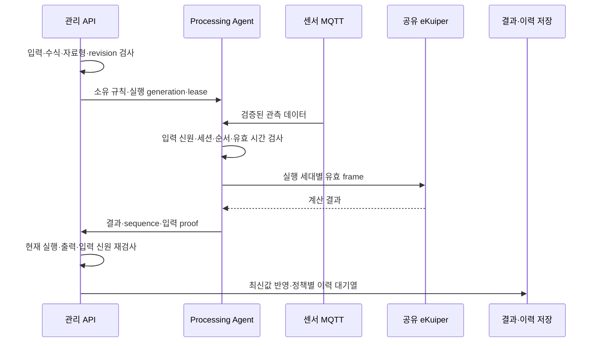

# eKuiper 기반 조합형 가상디바이스 연속 처리

**기술메모 TM-02** · 2026-10-20

과제명: (기입) · 작성자: (기입) · 검토자: (기입)
기준 소스: `1170c1e88667ea22bba2b21844456c18821e0213`

## 개요

여러 센서의 데이터를 계속 계산해 가상 센서의 출력으로 제공한다. 공유 eKuiper 엔진과 Processing Agent를 사용하며, VD마다 SERVICE나 supervisor, Pod를 만들지 않는다. 사용자가 입력과 계산식을 등록하면 서버가 이를 검사하고 엔진 규칙으로 변환한다. [1][2]

개발한 부분은 입력 목록, 연결·버전 관리, 계산식 검사와 규칙 생성, 엔진 실행 관리, 결과 확인, 저장 정책, 조합 등록 화면이다. eKuiper 엔진은 기존 소프트웨어를 사용한다. 현재 방식은 과거 VD v1·v2의 Runner 실행 방식과 다르다. [3]

| 기능 | 내용 |
|---|---|
| 입력 선택 | 센서, property, 별칭, 데이터 유효 시간 지정 |
| 계산 정의 | 제한된 수식과 윈도우 연산을 엔진 규칙으로 변환 |
| 조합 등록 | 온도·회전·가속도 조합 10종 제공 |
| 실행 관리 | 시작, 중지, 설정 변경, 등록 해제 |
| 출력 관리 | 최신값, 실행 세대, 저장 상태, 결과 이력 조회 |

## 처리 구조

Mapper가 UID, 수집 설정, 세션 순번을 포함한 데이터를 발행한다. Processing Agent는 지정한 센서의 최신 유효 데이터인지 확인한 뒤 엔진으로 전달한다. 서버는 등록 버전과 실행 세대를 부여하고, 현재 실행에서 보낸 결과만 반영한다. 이전 규칙이나 세션의 결과가 최신값을 덮어쓰지 않도록 한다. [1]

| 단계 | 확인할 정보 | 처리 내용 |
|---|---|---|
| 입력 선택 | UID, property, 별칭 | 지정한 항목만 연결 |
| 정의 등록 | 입력, 계산식, 저장 정책 | revision 검사와 이전 정의 보관 |
| 실행 준비 | 규칙 소유 정보, lease, generation | 현재 명령에 맞는 규칙 적용 |
| 계산 | 자료형과 측정 시각 | 유효한 데이터만 사용 |
| 결과 수신 | VD, 출력, revision, generation | 현재 실행과 일치하는 결과 반영 |
| 결과 저장 | NONE, SELECTED, ALL | 저장 정책에 따라 보관 |

설정이 바뀌면 새 revision을 만들고 이전 정의와 SQL 템플릿을 남긴다. API는 임의 SQL이나 sink 실행 요청을 받지 않는다. 정의 이력에서 당시 입력과 계산식을 확인할 수 있다.

등록을 해제하면 계산을 중지하고 입력 연결을 끝낸다. 물리 센서와 저장된 결과, 정의 이력은 유지한다. 규칙을 다시 만드는 기능이 있으며, 중단 전 윈도우 상태나 과거 데이터를 자동 복원하지는 않는다.

## 조합형 등록

| 조합 | 종류 수 | 계산 |
|---|---|---|
| 통합 온도 | 1 | 두 온도의 평균 |
| 온도 편차 | 1 | 첫 번째 온도에서 두 번째 온도를 뺀 값 |
| 회전 제곱합 | 4 | XYZ 또는 XY·XZ·YZ 축 제곱합 |
| 가속도 제곱합 | 4 | XYZ 또는 XY·XZ·YZ 축 제곱합 |

조합에 맞는 축과 숫자형 센서를 선택해야 하며, 입력 단위는 같아야 한다. 같은 측정 항목을 중복 선택할 수 없다. 제곱합의 출력 단위는 입력 단위의 제곱이다. 예를 들어 입력이 3과 4이면 평면 제곱합은 25이다. Vue 등록 화면에서도 기존 공통 preset을 사용한다. [4]

고급 설정으로 전환해도 입력과 계산식을 유지한다. 역할 누락, 잘못된 축, 중복 입력, 단위 불일치는 등록 전에 알린다. 등록에 실패해도 입력한 내용은 남긴다.

## 결과 저장

| 정책 | 동작 |
|---|---|
| NONE | 이력은 저장하지 않고 최신 유효값 제공 |
| SELECTED | 선택한 출력 중 조건을 만족하는 결과 저장 |
| ALL | 모든 출력 저장 |

저장 정책은 계산식이나 엔진 출력을 바꾸지 않는다. 조건식의 `value`는 계산 결과를 뜻한다. [1]

결과의 `SKIPPED`, `PENDING`, `STORED`, `EXPIRED`는 각각 저장 제외, 저장 대기, 저장 완료, 대기 중 보관 기한 만료를 나타낸다. 저장소에 장애가 나면 PostgreSQL 대기열에 보관하고 복구 후 다시 전달한다. 대기열에는 개수와 보관 기한 제한이 있다.

## 계산 정의와 실행 상태를 분리한 이유

계산식이 같아도 입력 센서가 교체되거나 Mapper가 재시작되면 이전 윈도우의 표본을 그대로 섞어서는 안 된다. 또한 서버가 규칙 생성 요청을 보냈다는 사실만으로 엔진이 현재 입력을 사용해 계산하고 있다고 판단할 수 없다. 이 때문에 정의 revision, 실행 generation, 규칙 소유권과 lease를 나누어 관리한다.

| 요구사항 | 설계 조건 | 시험에서 볼 항목 |
|---|---|---|
| R02-01 제한된 계산 정의 | 허용한 수식·연산·자료형만 규칙으로 변환 | 잘못된 수식·boolean 윈도우 거절 |
| R02-02 원본과 실행 세대 구분 | 입력 UID·설정·generation, 출력 실행 generation 대조 | 이전 세션·이전 규칙의 결과 거절 |
| R02-03 윈도우 상태 격리 | VD와 실행 세대에 맞는 frame과 윈도우 구성 | 다른 VD·재시작 표본의 혼합 방지 |
| R02-04 최신값과 저장 분리 | 계산 결과 유효성과 이력 저장 상태를 별도 관리 | 저장소 장애 중 최신값 갱신·대기열 유지 |
| R02-05 정의 변경 추적 | revision과 당시 정의·SQL 템플릿 보관 | 수정 전후 정의 이력 조회 |

## 입력·계산·출력의 상세 처리

공개 등록 요청은 입력 연결과 계산 정의를 받는다. 서버는 이를 `edgeai.vd/v3` Profile과 AUTO 배치 정보로 구성한다. 사용자가 임의의 SERVICE, SQL, sink 주소를 전달해 엔진을 조작하는 경로는 제공하지 않는다. 같은 key에 같은 등록 내용이면 기존 등록을 반환하고, 내용이 다르면 충돌을 반환한다. 수정 요청은 현재 revision을 요구한다.

### 계산 정의의 범위

| 항목 | 허용 범위·조건 |
|---|---|
| 입력 alias·출력 개수 | 각각 1~16개, 입력 alias마다 측정 항목 정확히 하나 |
| 계산 주기 | `intervalSeconds` 1~3,600초 |
| 입력 유효 시간 | `maxAgeSeconds` 기본 30초, 1~300초 |
| 결과 보관 기간 | `retentionDays` 1~30일 |
| 수식·단위 길이 | 수식 최대 1,024자, 출력 단위 최대 32자 |
| 연산 | scalar·movingAverage·minimum·maximum·threshold·filter |
| 윈도우 표본 수 | 이동 평균·최솟값·최댓값에서 `sampleCount` 1~1,024 필수 |
| 자료형 | 수치 윈도우에 boolean 금지, threshold와 condition은 boolean 식 필요 |

이 값들은 [ContinuousInput](../../backend/app/src/main/java/io/edgeai/app/support/ContinuousInput.java)과 [VirtualDeviceInput](../../backend/app/src/main/java/io/edgeai/app/support/VirtualDeviceInput.java)의 입력 한도다. 화면의 기본 선택값과 서버 API에서 생략할 수 있는 필드는 다르다. 예를 들어 조합 화면에 1초·최근 5개·7일이 미리 채워져도 API의 필수 필드를 빼도 된다는 뜻은 아니다.

이동 평균은 계산 주기마다 만들어진 유효 frame의 지정 개수를 사용하는 윈도우다. 센서가 서로 다른 시점에 측정한 값을 물리적으로 동시 측정한 값으로 바꾸는 기능은 아니다. 두 센서 평균 `(a+b)/2`와 그 결과의 최근 3개 이동 평균은 서로 다른 연산이며, 출력 이름·단위·윈도우 크기로 이를 명확히 해야 한다.

### 입력 갱신과 윈도우 초기화

Agent는 broker 경로, 장치 UID·property·source generation·설정 digest·type·unit을 검사한다. session과 sequence로 중복·역순·이전 실행 데이터를 구분한다. 필수 입력이 없거나 유효 시간을 넘으면 WAITING_INPUT이 되며, 이미 예열된 상태에서 입력 세션이 바뀌면 INPUT_CHANGED로 일시 중지하고 창 상태를 분리한다.

계산 tick은 유효한 lease와 설치된 규칙이 있을 때만 실행한다. 계산 슬롯이 건너뛰면 TICK_GAP, 조건 없이 나와야 하는 출력이 오지 않으면 EVALUATION_TIMEOUT으로 처리한다. 마지막 결과를 새 결과로 반복 제출해 빈 구간을 숨기지 않는다. 처리 근거는 [입력 검사](../../mappers/internal/processing/mqtt.go)와 [평가 루프](../../mappers/internal/processing/evaluate.go)에 있다.

### 결과 검증과 저장 대기열

서버는 결과의 엔진 신원·session·lease, 현재 VD generation과 outputId를 검사한다. evaluationId와 sequence, 평가 시각의 대응을 확인하고 입력 proof의 alias·UID·설정 digest·source generation·유효 시간도 다시 대조한다. 이전 실행에서 늦게 도착한 결과나 현재 입력과 다른 원본의 결과는 최신값으로 반영하지 않는다.

저장할 결과는 PostgreSQL 대기열에 기록한 뒤 InfluxDB로 전달한다. 대기열 기본 한도는 100,000개이고 허용 설정 범위는 64~1,000,000개다. 한 번에 64개를 전달하며 저장 실패 시 대기 항목을 성공으로 바꾸지 않는다. 보관 기한이 지난 항목은 EXPIRED로 구분한다. 이 한도와 보관 기간 때문에 저장 장애가 무기한 계속돼도 모든 결과를 영구 보존한다고 주장할 수는 없다. [대기열 전달 구현](../../backend/app/src/main/java/io/edgeai/app/service/ProcessingHistoryDelivery.java)에 관련 동작이 있다.

## 구현과 시험 결과

Spring의 `ContinuousRegistrationService`와 `ContinuousRuleCompiler`가 입력·계산식을 검사한다. `ProcessingEngineService`와 실행 서비스는 규칙, lease, 상태를 관리한다. Go Processing Agent는 eKuiper의 입력과 결과 전달을 담당한다.

| 시험 | 확인한 내용 | 근거 |
|---|---|---|
| 실제 엔진 연동 | MQTT → Agent → eKuiper → 결과 전달, 윈도우 분리 | 처리 시험 [1] |
| 세션 변경 | Mapper session 70회 교체와 이전 session 거절 | 처리 시험 [1] |
| 조합 등록 | 10종의 수식·입력 순서·단위, 잘못된 선택 차단 | 2026-10-14·19 시험 기록 [5] |
| 실센서 구성 | 센서별 통계와 조합 출력 확인 | 2026-10-14 구성 직후 기록 [5] |
| native UI | 등록 요청, 이력 자동 갱신, 확대 유지, 조회 오류 처리 | 브라우저·HTTP 시험 [5] |

2026-10-19에는 센서·VD 이력의 5초 갱신과 일시정지도 확인했다. 실제 센서 구성 시험은 당시 환경과 짧은 구간의 결과이며, 최대 처리량이나 장기 운전을 검증한 결과는 아니다.

### 계산·저장 정책의 구체적 시험

| 시험 ID | 입력·조치 | 기대 결과 | 근거·실행 구분 |
|---|---|---|---|
| TC02-01 | `a+b`를 sampleCount 3 이동 평균으로 정의 | VD·실행 세대별 윈도우, 3개 충족 조건과 평가 ID가 포함된 SQL 생성 | `ContinuousRuleCompilerTest`, 이번 개정 중 통과 |
| TC02-02 | boolean 입력을 이동 평균에 사용 | 자료형 오류로 거절 | 같은 단위 시험, 이번 개정 중 통과 |
| TC02-03 | SELECTED에서 temperature `value>=30`, alarm `value==true`, 값 20·40·true 전달 | 최신값은 갱신하고 선택 조건을 만족하는 결과만 저장 | 기존 `ContinuousRegistrationIntegrationTest`의 정의·과거 시험 근거 |
| TC02-04 | 저장소 장애 중 결과 21·22·23 수신 후 복구 | 최신값 23 유지, 대기 결과 재전달, 중복 수신으로 새 결과 증가 금지 | 같은 통합 시험의 장애·재전송 시나리오 |

2026-10-20 문서 개정 중 컴파일러 단위 시험 2개를 다시 실행해 실패·오류·건너뜀 0건을 확인했다. 이는 규칙 생성과 자료형 검사의 재확인이며 실제 eKuiper 수치 계산이나 운영 저장소 장애를 새로 시험한 결과는 아니다. [컴파일러 시험](../../backend/app/src/test/java/io/edgeai/app/support/ContinuousRuleCompilerTest.java)과 [등록·저장 통합 시험](../../backend/app/src/test/java/io/edgeai/app/integration/ContinuousRegistrationIntegrationTest.java)에 입력과 assertion이 있다.

새 환경에서 인수할 때는 입력 원본의 식별자, 계산 주기·표본 수, 결과의 revision·generation·evaluationId, 최신값과 이력 저장 상태를 함께 확인해야 한다. 단순히 규칙 목록에 이름이 보인다는 이유만으로 현재 입력을 사용한 계산 성공으로 판단하지 않는다.

## 사용 조건과 제한 사항

Mapper가 검증된 형식의 데이터를 실제로 보내는지 확인해야 한다. capability, 세션 순서, source generation을 확인하고 Agent·저장소·네트워크를 준비한 뒤 연속 계산을 켠다. 기본 설정은 비활성이다.

현재 보호 한도는 VD 200개, 출력 500개다. 이 수치가 장시간 실측한 처리 성능을 뜻하지는 않는다. 입력 주기와 윈도우, 출력 수에 따라 별도 시험이 필요하다. [1]

중단된 윈도우 복원, 과거 원본 전체 재생, VD 500개 동시 실행, 24시간 손실·중복 검증은 남아 있다. 설치와 중지·복구 절차는 [TDP-01](TDP-01_센서_수집과_가상디바이스_처리.md)을 참고한다.

## 참고 자료

1. [연속 계산과 데이터 저장](../guides/vd-processing.md)
2. [가상 센서 관리](../guides/virtual-devices.md)
3. [구형 VD 종료와 후속 처리 규격](../adr/0115-retire-legacy-virtual-devices.md)
4. [조합 preset 구현](../../dashboard/app/virtual-devices/continuous-presets.ts)
5. [구현·시험 기록](../../PROGRESS.md)
6. [남은 개발·검증 항목](../../PLAN.md)
