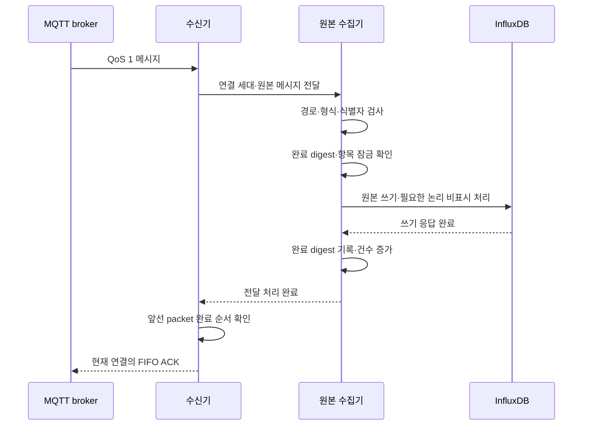

# MQTT 센서 데이터 저장 안정화와 중복 처리

**기술메모 TM-03** · 2026-10-20

과제명: (기입) · 작성자: (기입) · 검토자: (기입)
기준 소스: `1170c1e88667ea22bba2b21844456c18821e0213`

## 개요

MQTT로 받은 센서 데이터를 검사하고, 유효 관측은 InfluxDB 저장이 끝난 뒤 메시지 수신을 승인한다. QoS 1 재전송, 구형·검증 형식의 중복, 저장 지연과 장애를 처리하면서 측정 시각과 식별 정보를 유지한다. Twin의 최신값을 주기적으로 저장하는 방식과 별도로, Mapper가 보내는 데이터를 직접 수집한다. [1]

개발 중에는 수신 한도만 늘리면 저장 대기가 쌓이는 문제가 있었다. InfluxDB 2.9.1에서는 동기 DELETE와 TSI 작업이 서로 기다리면서 수집이 멈추기도 했다. 저장 작업 수를 제한하고 ACK 순서를 관리했으며, 중복 정리에서 동기 DELETE를 제거했다. [2][3]

| 항목 | 처리 방법 |
|---|---|
| 데이터 식별 | UID, property, 설정, generation, session, sequence 유지 |
| 수신 승인 | 저장 완료 후 QoS 1 수동 ACK |
| 동시 처리 | 전체 작업 수 제한과 측정 항목별 순서 관리 |
| 중복 처리 | 검증 형식 우선, 중복 구형 데이터는 조회에서 제외 |
| 이력 조회 | 원래 측정 시각, cursor, 원본 문서 보존 |

## 저장과 ACK 처리

수집기는 메시지를 읽고 규격과 식별 정보를 검사한 뒤 저장 작업을 시작한다. 같은 항목의 데이터는 순서대로 처리하고, 서로 다른 항목은 나누어 처리한다. 한 항목의 지연이 전체 수집을 오래 막지 않도록 했다. [2]

| 순서 | 처리 | 실패하거나 대기할 때 |
|---|---|---|
| 1 | 메시지와 규격 검사 | 잘못된 데이터는 유효 원본으로 처리하지 않음 |
| 2 | 저장 작업 자리 확보 | 한도에 도달하면 대기 |
| 3 | 중복 정리와 Influx 쓰기 | 실패한 저장은 완료로 처리하지 않음 |
| 4 | 완료 digest 기록 | 저장에 성공한 메시지만 캐시에 추가 |
| 5 | 연결별 수신 순서로 ACK | 앞선 메시지의 저장이 끝나기 전에는 승인하지 않음 |

전체 저장 작업 한도는 64개다. 가상 스레드와 공정 잠금으로 항목별 대기를 분리한다. 최근 4,096개의 동일 경로·payload digest는 메모리에 보관해 저장이 끝난 메시지의 중복 쓰기를 줄인다. 저장에 실패한 메시지는 이 캐시에 넣지 않는다. 재시작하면 원본 식별 정보로 저장 여부를 다시 확인한다. [2]

검사에 통과한 유효 관측의 MQTT ACK는 저장 완료 뒤에 보낸다. retained 메시지, 현재 경로에 해당하지 않는 메시지와 형식 오류는 저장 대상에서 제외하면서 ACK할 수 있다. 워크플로 STREAM에서 소비자가 계산을 끝냈다는 처리 ACK와도 다르다. 장애 중 재전달 가능한 범위는 broker의 큐·영속화·세션 만료 설정에 따라 달라진다.

## 데이터 식별과 중복 처리

### 같은 시각의 서로 다른 데이터

검증된 데이터는 source generation, session, sequence를 유지한다. 측정 시각이 같아도 sequence가 다르면 별도로 저장한다. Influx 내부 point 시각의 1ms 미만 부분을 식별에 사용할 수 있지만, API의 `observedAt`은 원래 측정 시각을 반환한다. [1]

구형 DataModel에는 sequence가 없어 개별 측정을 완전히 구분하기 어렵다. UID·항목·설정·측정 시각·자료형·값이 같은 구형 및 검증 데이터가 함께 오면 검증 데이터를 남긴다. 값이나 sequence가 다른 데이터는 합치지 않는다.

### 조회에서 중복 제외

중복 구형 point를 즉시 DELETE하던 방식을 바꾸어 빈 문서와 `archive_visible=false`를 기록한다. 새 원본에는 `archive_visible=true`를 기록한다. 목록과 이력은 빈 문서를, 차트는 비표시 항목을 제외한다. [2]

| 항목 | 동작 |
|---|---|
| 중복 구형 문서 | 조회에서 제외 |
| 기존 typed field | bucket 보관 기한까지 물리적으로 남을 수 있음 |
| 원본 조회 API | 표시 조건에 맞는 데이터 반환 |
| Influx 직접 조회 | 같은 표시 조건을 직접 적용해야 함 |

이는 InfluxDB의 DELETE 버그를 수정한 것이 아니라 수집 경로에서 문제를 피한 방법이다. 같은 경로에 동기 DELETE를 다시 넣으면 문제가 재발할 수 있다.

## 장애 원인과 변경의 범위

문제는 수신 한도를 늘리는 것만으로 저장 처리량이 같은 비율로 늘지 않는다는 점이었다. 느린 저장 작업이 쌓이면 뒤의 MQTT 전달이 기다리고, 같은 측정 항목의 순서와 연결 전체의 승인 순서도 함께 고려해야 한다. 여기에 InfluxDB의 동기 DELETE·TSI 대기가 겹치면 저장 완료가 돌아오지 않아 수집이 정체될 수 있었다.

현재 구현은 작업 수 제한, 항목별 공정 잠금과 저장 완료 후 FIFO ACK를 결합한다. 동시에 중복 정리에서 동기 DELETE를 빼 저장 경로가 해당 작업을 기다리지 않게 했다. 이 변경은 InfluxDB 내부 결함을 해결하거나 broker가 가진 모든 데이터를 끝까지 보존한다는 의미가 아니다.

| 요구사항 | 처리 조건 | 확인할 지표·시험 |
|---|---|---|
| R03-01 저장 전 유효 관측 승인 방지 | append 성공 전 완료 처리·ACK 금지 | 첫 저장 실패 후 같은 전달 재시도 |
| R03-02 중복 재전송 흡수 | 저장 성공 digest만 최근 완료 캐시에 기록 | 동일 payload 반복 시 append 횟수 확인 |
| R03-03 서로 다른 원본 보존 | 같은 시각이어도 sequence가 다르면 다른 관측 | 동시각 sequence별 이력 건수 확인 |
| R03-04 무관 항목의 지연 격리 | UID·property별 잠금, 전체 동시 작업 64개 | 한 항목 쓰기 정지 중 다른 항목 완료 |
| R03-05 조회 중복 제거 | qualified 우선·논리 비표시 조건 사용 | legacy 도착 순서별 이력·차트 대조 |

## 수신·저장·ACK의 상세 순서

수신기는 QoS 1 수동 ACK와 `cleanStart=false`, 세션 만료 86,400초를 사용한다. receive maximum은 256이며 실제 동시 저장은 공정 Semaphore 64개로 제한한다. 같은 packet ID의 재전달은 동일 완료 소유자에 연결하고, 재접속 전 작업이 새 연결에 ACK하지 못하게 연결 세대도 구분한다. [MqttObservationSubscriber](../../backend/adapters/src/main/java/io/edgeai/adapters/metrics/MqttObservationSubscriber.java)가 수신·완료 순서를 담당한다.

수집기는 route와 payload의 digest를 계산하고 UID·property별 공정 잠금 안에서 원본을 쓴다. append가 실패하면 완료 digest에 넣지 않고 같은 전달을 다시 시도한다. 완료 캐시는 최근 4,096개인 메모리 LRU이므로 영구 중복 제거 저장소는 아니다. 오래된 재전송이나 재시작 뒤의 데이터는 저장된 원본 식별자와 중복 정리 규칙을 함께 사용한다. [SensorArchiveCollector](../../backend/app/src/main/java/io/edgeai/app/service/SensorArchiveCollector.java)에 이 흐름이 구현되어 있다.

### 승인한 메시지와 저장한 원본의 차이

| 입력 분류 | 저장·승인 처리 | 운영상 확인 |
|---|---|---|
| 유효한 새 관측 | 저장 완료 뒤 ACK | 저장 건수·최신 관측 시각 증가 |
| 최근 저장 완료한 동일 전달 | 중복 append를 줄이고 완료 처리 | delivery 수와 신규 원본 수가 다를 수 있음 |
| retained 또는 현재 경로 외 메시지 | 정책상 제외 후 ACK 가능 | 신규 원본 수로 세지 않음 |
| 형식·신원 검사 실패 | 유효 원본으로 저장하지 않고 rejected에 반영 | 오류 원인과 rejected 증가 확인 |
| 저장소 장애 | 유효 관측을 완료로 처리하지 않고 재시도 | 대기와 STORE_UNAVAILABLE 상태 점검 |

수신 ACK 개수와 이력 행 수가 항상 같다는 수용 기준은 적절하지 않다. 신규 유효 관측의 식별자·내용·측정 시각을 대조해야 한다. 중복과 정책 제외를 구분하지 않으면 정상적인 재전송 처리도 데이터 손실로 잘못 계산할 수 있다.

## 동일 시각·구형 형식의 저장 규칙

qualified 원본은 저장 시각의 나노초 부분과 series 식별에 sequence를 나누어 사용한다. 원래 관측 시각이 밀리초 기준일 때 `sequence % 1,000,000`을 1ms 미만 부분에 넣고, `sourceGeneration:sessionId:sequence/1,000,000`을 series로 구분한다. API 문서의 `observedAt`은 이 저장용 시각이 아니라 원래 관측 시각이다. 이 방법으로 같은 밀리초의 서로 다른 sequence를 보존한다.

legacy 형식에는 sequence가 없어 같은 값의 반복 관측을 완전히 구분할 수 없다. UID·property·설정·원시 시각·type·value가 같은 legacy와 qualified가 함께 있을 때만 qualified를 우선한다. qualified가 먼저 도착하면 대응 legacy 쓰기를 생략한다. legacy가 먼저 도착하면 qualified를 쓴 뒤 기존 legacy point의 문서를 빈 값으로 덮고 `archive_visible=false`로 표시한다.

조회에서는 빈 문서와 비표시 항목을 제외한다. 과거 typed field는 같은 point에 물리적으로 남을 수 있으므로 InfluxDB를 직접 조회할 때 표시 조건 없이 필드 수만 세면 API 이력과 달라질 수 있다. 원본 목록·이력·차트의 조건을 함께 유지해야 한다. 상세 구현은 [InfluxTelemetryRepository](../../backend/adapters/src/main/java/io/edgeai/adapters/repository/InfluxTelemetryRepository.java)에 있다.

차트는 원본이 100,000개 이하면 원래 시각과 값을 사용하고, 이를 초과하면 구간별 FIRST_MIN_MAX_LAST 방식으로 실제 표본을 선택한다. 새 평균이나 보간값을 측정값처럼 만들지 않는다. 차트의 표시 표본 수와 원본 전체 건수가 달라질 수 있으므로 원본 대조에는 이력 cursor 조회를 사용한다.

## 시험 결과

| 날짜·시험 | 결과 | 측정 범위 |
|---|---|---|
| 2026-10-14 실제 수집 대조 | 3분간 발행·저장 3,055건과 내용 일치 | 해당 센서와 시험 구간 |
| 2026-10-16 저장 경로 복구 | COLLECTING, rejected 0, 지연 약 0.65~1.02초 | 복구 후 짧은 구간 |
| 같은 날 저장 설정 | HDD WAL fsync 10ms 적용 후 저장 승인 | 해당 배포 환경 |
| 저장소 통합 시험 | 원본·중복·동시각 sequence·형식 조정·중단 후 복구 확인 | 격리 PostgreSQL과 실제 InfluxDB |

3분 대조와 이후 복구 시험은 별도 기록이다. 위 지연은 p95·p99나 장기 성능 보장값이 아니다. [1][3]

`make test-data-store`는 격리된 PostgreSQL, 실제 InfluxDB 2.9.1, 시험용 MQTT broker를 사용한다. 같은 메시지 재전송, 동시각의 다른 sequence, 구형·검증 형식의 도착 순서, 저장 실패 후 재시도를 확인한다. 발행·저장·조회 건수와 식별 정보, 값을 함께 비교한다.

### 이번 개정에서 다시 실행한 단위 시험

2026-10-20에 [SensorArchiveCollectorTest](../../backend/app/src/test/java/io/edgeai/app/service/SensorArchiveCollectorTest.java) 3개를 실행해 실패·오류·건너뜀 0건을 확인했다. 저장소는 통제된 mock이며 실제 InfluxDB 장애 시험을 새로 수행한 결과는 아니다.

| 시험 ID | 입력·조치 | 기대 결과 | 이번 결과 |
|---|---|---|---|
| TC03-01 | 값 23.5의 동일 메시지 두 번, 이후 24.5 전달 | append 총 2회, 정상 처리된 delivery는 3회 | 통과 |
| TC03-02 | 첫 append 실패 뒤 같은 payload 재전달, 이후 24.5 | 실패를 완료 캐시에 넣지 않음, 실패 호출 포함 append 총 3회 | 통과 |
| TC03-03 | 잠금 해시가 충돌하는 서로 다른 항목에서 첫 쓰기를 대기시킴 | 다른 항목은 1초 이내 완료 | 통과 |

[Influx 통합 시험](../../backend/app/src/test/java/io/edgeai/app/integration/InfluxDataStoreIntegrationTest.java)에는 legacy→qualified→legacy 재전송, 같은 시각·값의 다른 sequence, 불리언 false/true 보존을 검사하는 시나리오가 있다. 예를 들어 중복과 새 관측을 순서대로 전달하며 이력 행 수가 1→1→1→2→3→4가 되는지 검사한다. 이 통합 시나리오는 이번 문서 개정에서 재실행하지 않았다.

### 과거 실증 결과의 해석

3분 3,055건 대조는 2026-10-14의 실제 센서 구간 기록이다. 당시 고정 작업자 수 등 설정과 이후 가상 스레드 구현을 같은 시점의 구성으로 합치지 않는다. 10월 16일의 복구 지연 약 0.65~1.02초도 별도 짧은 구간 기록이다. 이번 개정에서는 당시 원시 발행 capture와 이력 export를 다시 집계하지 않았으며 [PROGRESS](../../PROGRESS.md)에 남은 결과를 인용했다.

새 수용 시험에서는 시험 시작·종료 시각, 센서 UID와 설정·generation, 신규 유효 관측 수, 중복·제외·rejected 수, 저장·조회 건수와 값·시각 대조, 저장 지연 분포를 함께 남긴다. 장기 무손실을 판정하려면 broker 영속화·세션 만료·저장 장애·API 재시작을 포함한 별도 시험이 필요하다.

## 개발 범위와 운영 조건

개발한 부분은 원본 저장 어댑터, 저장 완료 후 수동 ACK, 연결별 승인 순서, 처리 한도, 항목별 동시 처리, 중복 정리와 조회 조건이다. MQTT broker와 InfluxDB·PostgreSQL은 기존 소프트웨어를 사용한다.

저장 안정성은 실제 fsync 설정, broker의 영속화와 큐, 세션 만료, 디스크 용량에도 영향을 받는다. QoS 1과 메모리 캐시만으로 전체 데이터가 정확히 한 번 처리된다고 보장하지 않는다.

원본 bucket은 기본 30일, VD 결과 bucket은 1~30일 보관한다. 보관 기한이 지난 데이터의 영구 복구는 지원하지 않는다. 남은 물리 필드와 저장 공간도 bucket 보관 정책으로 관리한다. [1]

운영 점검에서는 새 측정 시각, 저장 건수 증가, 대기량을 확인한다. health 응답만으로 수집 정상 여부를 판단하지 않는다. 24시간 무손실, 장기 부하, 전체 장애 복구는 추가 검증이 필요하다. 설치와 시험 절차는 [TDP-01](TDP-01_센서_수집과_가상디바이스_처리.md)을 참고한다.

## 참고 자료

1. [연속 처리와 원본 저장](../guides/vd-processing.md)
2. [로컬 개발과 InfluxDB DELETE 우회](../guides/local-development.md)
3. [구현·시험 기록](../../PROGRESS.md)
4. [저장 어댑터](../../backend/adapters/src/main/java/io/edgeai/adapters/repository/InfluxTelemetryRepository.java)
5. [저장소 통합 시험](../../scripts/test/test-data-store.sh)
6. [남은 개발·검증 항목](../../PLAN.md)
