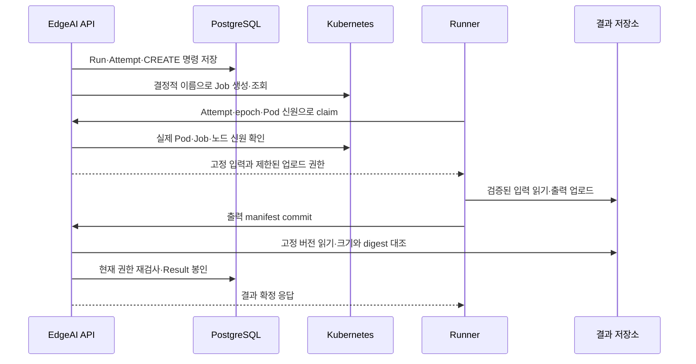

# DAG 기반 분산 작업 실행과 위치 전환 및 결과 검증

**기술메모 TM-04** · 2026-10-20

과제명: (기입) · 작성자: (기입) · 검토자: (기입)
기준 소스: `1170c1e88667ea22bba2b21844456c18821e0213`

## 개요

버전이 고정된 SERVICE 모듈을 DAG로 연결하고 Kubernetes에서 실행한다. 입력 파일, 작업 상태, 결과를 함께 관리하며 Run·Task·Attempt·Runtime을 구분해 재시도와 노드 이동을 추적한다. 실행 요청 접수와 계산 성공은 따로 판단한다. [1][2]

개발한 부분은 DAG 검사와 버전 관리, 중복 요청 처리, 작업 배치, Runner 인증, 결과 파일 검증, 취소, 실행 위치 전환이다. Kubernetes, S3 호환 저장소, Python 실행 환경은 기존 소프트웨어를 사용한다.

| 객체 | 역할 |
|---|---|
| ProfileVersion | SERVICE의 고정 버전과 입출력·실행 규격 |
| WorkflowVersion | 작업과 연결을 발행한 DAG 버전 |
| Run | 특정 버전과 입력으로 시작한 실행 |
| Task | DAG의 개별 작업 |
| Attempt | 재시도나 노드 이동으로 구분되는 실행 시도 |
| Runtime | 실제 실행 프로세스와 Pod |
| Result | 검증을 마친 결과 |

편집 중인 그래프, 발행한 버전, 실행 중인 Run은 별도로 관리한다. 새 편집 내용을 기존 Run에 바로 반영하지 않는다.

## 실행 절차

DAG를 발행하기 전에 순환, 없는 포트, 중복 입력, 지원하지 않는 연결을 검사한다. 실행할 때는 고정 버전과 매개변수, AUTO·NODE 등의 배치 정책을 지정한다. 같은 요청을 다시 보낼 때는 같은 `Idempotency-Key`를 쓰고, 새 실행에는 새 키를 쓴다. [1]

| 단계 | 처리 | 확인 기준 |
|---|---|---|
| 접수 | 버전·입력·정책 저장 | 같은 키의 요청 내용 일치 |
| 계획 | 의존성과 자원 조건에 맞는 Attempt 생성 | DB 상태와 현재 노드 조건 |
| 배정 | Runtime과 Pod 생성 | 계획한 실행 정보와 실제 Pod 일치 |
| claim | Runner 실행 권한 확인 | Attempt, epoch, Pod 인증 정보 |
| 실행 | 입력 다운로드 후 자식 프로세스 실행 | 입력 크기와 digest 일치 |
| 결과 | 출력 업로드와 commit 요청 | 현재 실행의 권한과 파일 내용 확인 |

### 결과 파일 검증

Runner는 입력 파일을 내려받아 SHA-256을 검사한 뒤 `command`와 `args`로 자식 프로세스를 실행한다. shell을 거치지 않는다. 출력은 일반 파일만 허용하고, 누락 파일과 심볼릭 링크는 거절한다. [2][3]

업로드한 결과는 고정 object version, 파일 크기, digest를 대조한 뒤 확정한다. 업로드가 끝나거나 Pod가 종료됐다는 이유만으로 Task를 성공 처리하지 않는다. 이전 Attempt의 늦은 commit도 현재 결과를 덮어쓸 수 없다.

취소하거나 실행 기한이 지나면 프로세스 그룹을 종료하고 자원 회수 상태를 확인한다.

## 재시도와 노드 이동

재시도와 위치 전환은 같은 Task에 새 Attempt와 epoch를 만든다. 장애 재시도 횟수와 OFFLOAD 횟수는 따로 계산한다. 이전 실행이 끝나고 권한이 회수됐는지, 미완료 CREATE가 정리됐는지 확인한 뒤 다음 시도를 시작한다. [4][5]

| 상황 | 처리 |
|---|---|
| 응답 유실 | 같은 키로 요청 재전송 |
| 실행 실패 | 정책에 정한 횟수 안에서 재시도 |
| 사용자가 노드 변경 | 다른 호환 노드와 실행 조건 확인 |
| STREAM 그룹 이동 | 연결 그룹과 고정 checkpoint 등 전환 조건 확인 |
| 취소·기한 초과 | 새 실행과 충돌하지 않도록 처리하고 이전 실행·권한 정리 |

자동 전환은 CPU·메모리·서비스 지연, 기준을 연속 충족한 횟수, 전환 후 대기 시간, 최대 전환 횟수를 사용한다. 측정값이 없거나 오래됐으면 조건을 충족한 것으로 보지 않는다.

전환 Operation의 `SUCCEEDED`는 새 실행 시작 또는 위치 전환이 끝났다는 뜻이다. 최종 계산 결과의 성공은 Result로 확인한다. 웹에서는 대상, 상태, 실패 코드, 판단 기준, 그룹별 checkpoint와 Attempt를 보여준다.

현재는 RESTART와 지원 조건을 갖춘 일부 STREAM 전환을 제공한다. 임의의 상태형 모델을 모두 복원하는 기능은 아니다. 구형 VD supervisor와 Runner VD 실행 정책도 다시 사용하지 않는다.

## 설계 과제와 판단 기준

이 기능의 핵심 과제는 네트워크 재요청, Pod 중복 생성, 늦은 결과 제출이 발생해도 하나의 논리 작업에 서로 다른 결과가 확정되지 않게 하는 것이다. 실행 요청과 외부 자원 생성은 하나의 데이터베이스 트랜잭션으로 묶을 수 없다. 따라서 실행 의도는 DB에 먼저 남기고, 외부 명령은 다시 실행해도 같은 대상을 식별할 수 있게 구성했다. 설계 근거는 [실행·결과 규격](../adr/0005-runtime-result.md)에 있다.

| 요구사항 | 구현에서 유지하는 조건 | 확인 방법 |
|---|---|---|
| R04-01 재요청 시 중복 실행 방지 | 멱등 키와 정규화한 요청이 같으면 기존 Run 반환 | 최초 요청과 재요청의 Run ID 비교 |
| R04-02 발행한 실행 정의 보존 | Run은 봉인된 WorkflowVersion을 참조 | 같은 버전에 다른 DAG 발행 시 충돌 확인 |
| R04-03 현재 실행의 결과만 확정 | Attempt·epoch·producer claim을 결과 확정 직전에 재검사 | 이전 Attempt의 commit 거절 확인 |
| R04-04 파일 내용 검증 | 고정 object version의 실제 byte로 크기·SHA-256 대조 | 입력 또는 출력 손상 시 성공 처리 금지 |
| R04-05 전환 중 이중 실행 억제 | 이전 실행 권한 차단·실제 종료 확인 후 새 Attempt 시작 | 종료 지연·늦은 CREATE 응답의 처리 확인 |

여기서 요구사항 번호는 이 문서의 설명과 시험을 연결하기 위한 식별자다. 기관의 공식 등록번호를 뜻하지 않는다.

## 실행 신원과 결과 확정 과정

다음 그림은 Kubernetes SERVICE의 정상 실행 경로를 나타낸다. BATCH 후속 작업은 검증된 선행 결과를 받은 뒤 같은 과정을 시작한다.

Runner 인증에는 실행 전용 Bearer token과 Pod에 결합된 token을 사용한다. 서버는 TokenReview뿐 아니라 실제 Pod의 UID, Job 소유 관계와 실행 상태도 대조한다. 같은 Job에서 생성된 다른 Pod가 동일한 실행 권한을 공유한다고 가정하지 않는다. 실행 전용 인증을 공개 관리 API의 로그인 세션과 혼용하지 않는다.

입력 파일은 고정 버전으로 내려받아 크기와 SHA-256을 검사한 후 계산에 사용한다. 결과 commit에서는 서버가 허용한 포트·저장 위치·자료형·크기를 검사하고, 해당 object version을 직접 읽어 내용을 대조한다. 검증 I/O가 끝나면 Run 잠금을 다시 잡고 취소 여부와 현재 claim을 확인한다. 이 확인 뒤에 Result·Artifact와 Task/Attempt의 성공 상태를 함께 저장한다. 검증 중 취소된 작업은 파일이 올바르더라도 성공으로 확정하지 않는다.

데이터베이스에는 성공한 결과를 봉인하는 제약이 있다. 봉인 후 결과나 파일 목록을 바꾸거나 새 Artifact를 덧붙이지 못하게 한다. 같은 producer가 같은 manifest를 다시 제출한 경우와, 다른 내용으로 결과를 교체하려는 경우를 구분한다. API 상세 응답에는 결과의 식별 정보와 digest를 제공하고 서명 URL이나 실행 token을 넣지 않는다. [결과 응답 구현](../../backend/app/src/main/java/io/edgeai/app/dto/TaskResultsResponse.java)에서 공개 필드를 확인할 수 있다.

### 실행 매개변수의 적용

TaskDefinition의 `parameters`에 Run의 `parameters`를 최상위 키 단위로 덮어쓴다. 중첩 객체를 재귀적으로 합치지 않는다. 예를 들어 작업 정의의 `options`와 Run의 `options`가 함께 있으면 Run 쪽 객체 전체가 우선한다. 합친 JSON은 64 KiB 이내여야 한다. 큰 정수는 JSON 정밀도를 유지하며 전달한다. 이 규칙은 같은 실행 요청의 재현 조건에도 포함된다.

### 실패 분기와 후속 작업

선행 Task가 성공하고 봉인된 결과가 있어야 BATCH 후속 Task를 준비한다. 선행 작업 실패 시 해당 작업에 의존하는 분기는 SKIPPED로 처리하고 독립 분기는 유지한다. 취소는 실행 권한을 먼저 차단하고 물리 자원 종료를 확인한다. API의 취소 응답만 보고 Pod가 이미 사라졌다고 판단하면 안 된다.

| 관측 상황 | 해석과 조치 |
|---|---|
| Run 접수 201 | 요청과 초기 실행 의도가 저장됨. 계산 성공은 미확정 |
| Job 또는 Pod 종료 | 프로세스 종료 관측. 검증된 Result 존재 여부를 따로 확인 |
| Result 검증 실패 | 고정 object version·byte·포트·현재 권한을 점검 |
| 전환 Operation 성공 | 새 target의 실행 시작이 확인됨. 이후 계산 결과는 별도 확인 |
| CANCELLING 지속 | 실제 종료 또는 미완료 외부 명령 정리를 기다리는 상태일 수 있음 |

## 자동 전환 조건의 해석

자동 전환은 전역 최적 배치를 계산하는 기능이 아니라 설정한 임계값을 연속해서 넘었는지 판단하는 정책이다. [OffloadPolicy](../../backend/domain/src/main/java/io/edgeai/domain/execution/OffloadPolicy.java)는 같은 Attempt의 연속 sequence, 관측 시각, 수신 시각과 표본 간 간격을 함께 검사한다. CPU 한 번, 메모리 한 번의 초과를 합쳐 같은 지표의 연속 초과로 취급하지 않는다.

| 설정 | 허용 범위·판정 의미 |
|---|---|
| CPU·메모리 임계값 | 각각 1~100%, 지연과 함께 적어도 하나의 임계값 필요 |
| 지연 임계값 | 1~600,000,000μs |
| 연속 표본 수 | 2~6개, 동일 지표가 모든 표본에서 기준 충족 |
| 최대 표본 나이 | 10~60초, 오래된 관측·수신 제외 |
| 최대 표본 간격 | 5~30초, 누락된 sequence와 불연속 시각 제외 |
| 최소 실행·전환 후 대기 | 각각 10~3,600초 |
| 최대 전환 횟수 | 1~8회, 재시도 예산과 별도 |
| drain·새 시작 제한 시간 | 각각 1~600초 |

임계값을 설정했다고 대상 노드의 가용 자원이나 실제 모델 성능이 보장되는 것은 아니다. 대상 호환성 검사와 실제 scheduler의 배치를 거친다. 메트릭 누락·시간 역전·서로 다른 Attempt의 혼합은 유효한 전환 근거로 사용하지 않는다.

## 시험 결과

| 시험 | 결과 | 범위 |
|---|---|---|
| 실제 NODE SERVICE | 입력 2·3, 가중치 4·5, bias 1로 결과 24 | 2026-10-16 API·Runner 실행 [6] |
| 결과 파일 검증 | object version·크기·SHA-256·공개 결과 일치 | 2026-10-14 입력 연계 실행 [6] |
| Runner 구성 요소 | 손상 입력, 누락·링크 출력, timeout, 취소, commit 재전송 검사 | HTTP fixture 시험 [2] |
| 위치 전환 | NODE 이동, 상태·권한 정리, 관련 STREAM 그룹 인계 | 해당 ADR의 시험 조건 [4][5] |
| 전환 이력 화면 | 대상·정책·checkpoint·상태 갱신, 새 시도 없는 실패 표시 | 2026-10-20 브라우저·HTTP fixture [6] |

2026-10-20 실제 API에서 Run 6개와 Task 12개를 읽어 저장된 STREAM 경로 6개를 확인했다. 조회한 Task에는 전환 이력이 없었으므로 전환 화면의 상태 변화는 fixture로 시험했다. [6]

Runner 재현 시험은 `scripts/test/test-runner.sh`를 사용한다. 실제 DB·broker·Kubernetes 시험은 별도로 준비한다. 중복 요청, 잘못된 인증 정보, 이전 epoch의 commit, 취소 후 결과 제출 거절을 확인하고 API 결과와 저장 파일의 byte를 대조한다.

### 대표 시험의 입력과 판정

| 시험 ID | 입력·실행 조건 | 기대 결과 | 확보된 근거 |
|---|---|---|---|
| TC04-01 | DAG에 자기 연결·순환·없는 Task·한 입력의 복수 producer 추가 | 발행 전 잘못된 DAG 거절 | `WorkflowDagTest.rejectsCyclesDuplicateKeysDanglingEdgesAndCompetingInputProducers` |
| TC04-02 | JSON에 정수 `9007199254740993` 사용 | 정규화 후 값 그대로 보존 | `WorkflowDagTest.strictInputNormalizesDagOrderAndPreservesLargeNumbers` |
| TC04-03 | 입력 `[2,3]`, 가중치 `[4,5]`, bias `1`로 NODE SERVICE 실행 | `2×4+3×5+1=24`, 검증된 결과 확정 | 2026-10-16 실제 실행 기록 [6] |
| TC04-04 | 입력 digest 불일치 또는 출력 파일 누락·심볼릭 링크 | 정상 결과로 commit하지 않음 | Runner의 입력 hash·출력 경로 시험 |
| TC04-05 | workload 실행 중 timeout·SIGTERM | 실제 자식 프로세스 종료, 정상 결과 오확정 방지 | Runner의 timeout·취소 시험 |

TC04-01·02는 [DAG 단위 시험](../../backend/app/src/test/java/io/edgeai/app/support/WorkflowDagTest.java), TC04-04·05는 [Runner 시험](../../runner/tests/test_runner.py)에 재현 입력과 assertion이 있다. 실제 장비의 결과를 새로 측정한 것으로 보려면 이미지 digest, Run/Task/Attempt ID, 대상 Node, 최종 Result와 고정 파일 버전을 함께 남겨야 한다. 기존 기록의 성공을 다른 이미지·장비의 성공으로 확대하지 않는다.

2026-10-20 개정 중 DAG 3개·자동 전환 정책 4개와 Runner 11개 시험을 다시 실행해 모두 통과했다. Runner는 실제 자식 프로세스를 사용하지만 제어 API·저장소는 로컬 HTTP fixture이므로 Kubernetes 전체 경로의 재실행 결과는 아니다.

## 배포 조건과 남은 검증

배포할 Runner 이미지의 digest와 아키텍처, 내부 TLS, Pod 인증, 결과 저장소의 versioning·읽기 권한이 필요하다. 적용한 Flyway migration은 수정하지 않는다. 설치와 시험 절차는 [TDP-02](TDP-02_워크플로_실행과_통합_운영.md)에 정리했다.

GPU·NPU의 실제 모델 실행, 외부 Remote 연동, 모든 상태형 서비스의 checkpoint 복원, 24시간 부하와 전체 장애 복구는 추가 검증이 필요하다. [6][7]

주요 소스는 `backend/domain`, `backend/app`, `backend/adapters`, `runner/`, `dashboard/kestra-native/`에 있다. 공개 관리 API와 내부 Runner API를 구분하며, Kestra는 UI를 사용한다. 실행 제어는 기존 EdgeAI 서버가 담당한다.

## 참고 자료

1. [DAG 구성과 실행](../guides/dag-execution.md)
2. [Runner 구현과 시험](../../runner/README.md)
3. [결과 검증 설계](../adr/0005-runtime-result.md)
4. [실행 중 위치 전환](../adr/0007-running-offload.md)
5. [재시도 횟수 관리](../adr/0006-retry-budget.md)
6. [구현·시험 기록](../../PROGRESS.md)
7. [남은 개발·검증 항목](../../PLAN.md)
