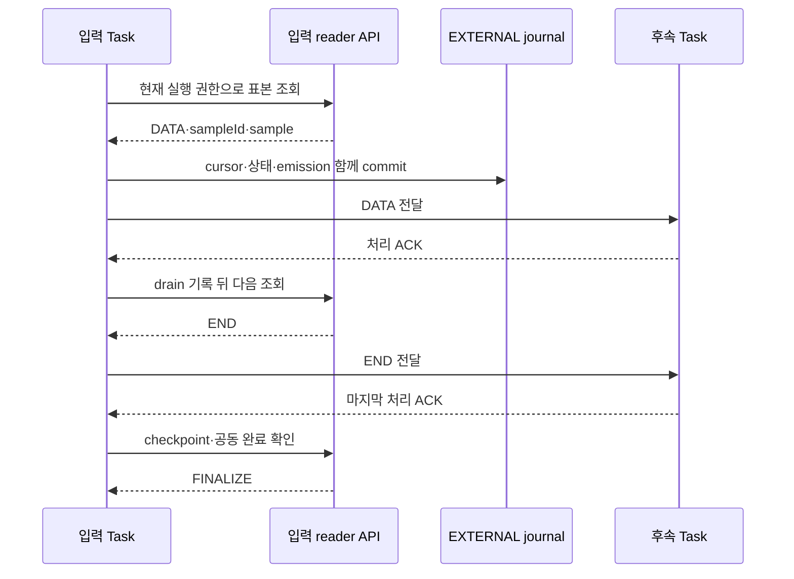

# 센서·가상디바이스 데이터의 실시간 워크플로 입력 연계

**기술메모 TM-05** · 2026-10-20

과제명: (기입) · 작성자: (기입) · 검토자: (기입)
기준 소스: `1170c1e88667ea22bba2b21844456c18821e0213`

## 개요

센서의 검증된 원본 데이터나 가상디바이스의 최신 유효 계산 결과를 SERVICE 워크플로의 입력으로 사용한다. 입력을 바꿔도 후속 처리 작업과 연결은 유지하며, 변경 사항은 새 DAG 버전과 새 Run에 적용한다. 실행 중에는 최신 유효값을 반복해서 읽어 처리 작업으로 전달한다. [1]

개발한 부분은 입력 목록, 원본 지정과 식별 정보 고정, 현재 작업만 접근할 수 있는 reader, 중복 표본 제거, EXTERNAL journal 연계, 정상 종료, 편집기의 입력 선택 화면이다. 센서 MQTT와 Task STREAM은 서로 다른 데이터·권한 체계를 사용한다. [2]

| 입력 | 읽는 데이터 | 변경 시 처리 |
|---|---|---|
| 센서 | NanoMQ 수집 경로에 저장된 최신 유효 원본 | UID·설정·source generation이 바뀌면 기존 Run 차단 |
| 가상디바이스 | eKuiper의 current VALID 출력 | revision·실행 generation이 바뀌면 기존 Run 차단 |
| 기존 BATCH 장치 입력 | Run 접수 시점의 최신값 | 접수 후 값을 계속 갱신하지 않음 |

현재 실시간 입력은 1초마다 최신값을 읽는다. 조회 사이에 발생한 모든 측정값을 전달하거나 과거 데이터를 재생하는 방식은 아니다.

## 입력 선택과 고정

`WORKFLOW_DATA` 모듈에서 입력 종류와 데이터를 고른다. 변경하는 값은 해당 작업의 `dataSource`이며, 노드 ID·다른 매개변수·후속 작업·연결·좌표는 유지한다. 이미 실행 중인 Run의 입력은 바꾸지 않는다. [1]

입력 목록은 로딩, 빈 목록, 조회 실패를 구분한다. 기존 입력이 목록에서 사라져도 다른 센서를 자동 선택하지 않는다. VD는 먼저 시작해 유효 결과가 있어야 한다. 결과 저장 정책이 NONE이어도 current VALID 출력은 입력으로 사용할 수 있다.

| 단계 | 확인할 정보 | 목적 |
|---|---|---|
| 버전 발행 | 입력 종류, 대상, property·output | 선택한 입력 보존 |
| Run 생성 | UID, 설정·revision, 실행 세대 | 실행 중 다른 원본으로 바뀌는 것 방지 |
| reader 접근 | 현재 Attempt와 Pod의 권한 | 다른 작업의 입력 접근 제한 |
| 표본 읽기 | 유효 시간, sampleId | 만료값 제외와 중복 제거 |
| journal commit | cursor, 상태, emission | 읽은 위치와 전달 상태를 함께 기록 |

값이 없거나 만료됐으면 유효값을 기다린다. 식별 정보가 바뀌면 기존 Run을 차단하고 새 버전·실행을 요청해야 한다. CRD 센서를 일반 DeviceSession의 UUID로 바꾸어 처리하지 않는다.

## 데이터 전달과 정상 종료

입력 SERVICE는 새 sampleId를 읽고 source cursor, 상태, emission을 같은 EXTERNAL journal commit에 기록한다. 기존 STREAM의 DATA·ACK·외부 checkpoint 규칙을 사용해 읽은 위치와 처리 완료 위치를 구분한다. 저장소에 업로드했다는 이유만으로 소비자의 처리 완료 위치를 앞당기지 않는다. [1][3]

센서 수집 MQTT의 PUBACK은 원본 저장 승인이다. Task STREAM의 ACK는 처리 확인이다. 1초 조회 방식이므로 두 승인을 연결해도 센서의 모든 측정값을 처리했다고 볼 수는 없다.

정상 종료는 다음 순서로 진행한다.

1. drain 요청으로 새 입력 읽기를 끝낸다.
2. 마지막 DATA와 END를 전달한다.
3. 처리 ACK와 서버가 확인한 checkpoint를 기다린다.
4. 연결 그룹의 FINALIZE를 기다린다.
5. 결과 파일을 저장하고 검증된 Result를 확인한다.

정상 종료와 강제 취소는 다르다. 예제 처리기는 표본 수·마지막 값·숫자 통계를 파일로 저장한다. SERVICE의 실행 시간 한도는 최대 24시간이다. [1]

저장소 오류, 권한 문제, 원본 세대 변경은 실행 상태와 오류로 알린다. 종료 요청을 보냈더라도 최종 상태와 Result까지 확인해야 한다.

## 최신값 입력을 선택한 이유와 적용 범위

이 경로는 원본 저장소나 VD 계산 결과를 기존 SERVICE 실행 체계에 연결하기 위한 것이다. 센서 수집 프로토콜과 실행용 STREAM을 직접 결합하면 센서 등록 방식, 메시지 순서와 실행 권한을 함께 변경해야 한다. 현재 구현은 서버가 원본의 신원을 고정하고, 권한이 있는 입력 Task가 최신 유효값을 읽어 기존 journal·STREAM으로 전달하도록 나누었다.

따라서 기존 물리 센서와 연속 VD의 데이터를 같은 후속 처리기에 연결할 수 있다. 반면 조회 주기 사이에 발생한 여러 관측 중 일부는 최신값에 덮여 전달되지 않을 수 있다. 원본 전량 분석, 정밀한 시간 정렬이나 재생이 필요한 작업은 이 경로의 결과 건수로 원본 무손실을 판정하면 안 된다.

| 요구사항 | 유지하는 조건 | 관련 구현·시험 |
|---|---|---|
| R05-01 입력 종류 구분 | SENSOR와 CONTINUOUS_VD의 필드를 엄격히 구분 | `WorkflowSourceInput`·`WorkflowSourceInputTest` |
| R05-02 원본 교체 감지 | Run에 고정한 UID·설정 또는 revision·generation과 현재 상태 대조 | `WorkflowDataInputService.pin/input` |
| R05-03 최신 유효값만 사용 | 유효 시각·quality·값 자료형 검사 | reader의 DATA/WAITING 판정 |
| R05-04 같은 표본 재발행 억제 | sampleId와 journal의 source cursor 연계 | WORKFLOW_DATA 입력 실행기 |
| R05-05 처리 후 정상 종료 | END·처리 ACK·FINALIZE 이후 파일 결과 확정 | SDK·Runner 종료 시험과 실제 실행 기록 |

## 선택 정보와 실행에 고정하는 정보

사용자는 연결 의도를 지정하고, 서버는 실행 시점에 실제 식별 정보를 추가한다. 사용자가 Run 요청에 내부 binding이나 broker 자격 증명을 넣어 reader의 대상을 임의로 바꾸게 하지 않는다. 발행된 입력 Task는 들어오는 의존 연결이 없어야 하고, 다음 Task로 향하는 STREAM 연결이 있어야 한다.

아래는 Task의 `parameters.dataSource`에 들어가는 선택 정보의 예시다. 장치명과 UUID는 설명용이며 실제 등록 값으로 바꾼다.

```json
{
  "kind": "SENSOR",
  "deviceId": "temperature",
  "property": "value"
}
```

```json
{
  "kind": "CONTINUOUS_VD",
  "vdId": "12345678-1234-4234-8234-123456789012",
  "outputId": "mean"
}
```

SENSOR에 `outputId`를 추가하는 식으로 두 입력 종류의 필드를 섞으면 거절한다. 센서 이름은 KubeEdge 등록 이름이며 일반 실행 Device의 UUID와 다르다. [선택 정보 검사](../../backend/app/src/main/java/io/edgeai/app/support/WorkflowSourceInput.java)는 허용 필드·식별자·측정 항목 이름을 검사한다.

| 종류 | Run 생성 시 추가로 고정하는 정보 | 실행 중 차단 조건 |
|---|---|---|
| SENSOR | `deviceUid`, `sourceGeneration`, `configurationSha256`, `type`, `unit` | 현재 등록 원본의 식별자·설정·자료형·단위가 달라짐 |
| CONTINUOUS_VD | `revision`, `profileVersionId`, `generation`, `type`, `unit` | VD 해제·정의 변경·실행 generation 변경 |

VD는 연속 처리 모드이고 현재 실행이 RUNNING이어야 하며, 선택 출력에 VALID 결과가 있어야 한다. 입력 목록에 나타났다는 사실만으로 Run 생성이 보장되지는 않는다. 목록을 읽은 뒤 실행하기 전 상태가 달라질 수 있으므로 생성 시 다시 검사한다.

## reader의 유효성 판정

[WorkflowDataInputService](../../backend/app/src/main/java/io/edgeai/app/service/WorkflowDataInputService.java)는 reader 요청마다 현재 Runner의 Attempt·epoch·Pod 권한을 확인한다. 요청 본문에서 임의의 센서 주소를 받지 않고, 해당 Task가 속한 Run의 binding을 사용한다.

센서 입력은 최근 30초 범위에서 최신 QUALIFIED 원본 한 건을 조회한다. 저장소가 비활성이거나 조회에 실패한 경우, 원본이 없거나 조회한 원본의 신원이 맞지 않는 경우에는 WAITING을 반환한다. VD는 현재 출력의 quality와 generation을 대조한다. 공통으로 관측 시각이 현재보다 2초 넘게 미래이거나 30초 이상 오래됐으면 기다린다. 값은 숫자 또는 불리언이어야 한다.

| reader 결과 | 의미 | 입력 실행기의 처리 |
|---|---|---|
| WAITING | 아직 유효한 표본을 제공할 수 없음 | 다음 조회를 기다림. 기존 값을 새 표본으로 만들지 않음 |
| DATA | 유효한 표본과 `sampleId` 제공 | 새 식별자인지 확인하고 journal에 기록 |
| END | 서버가 정상 종료 요청을 기록함 | 새 조회를 끝내고 후속 END·완료 절차 수행 |
| 409 `WORKFLOW_SOURCE_CHANGED` | 고정한 원본과 현재 원본이 달라짐 | 기존 Run에서 자동 대체하지 않고 새 실행 필요 |

sampleId는 고정 원본과 `sessionId`, `sequence`, `evaluationId`, 관측·평가 시각 중 제공되는 정보를 정규화해 만든 digest다. 단순히 값이 같다고 같은 표본으로 보지 않는다. 반대로 같은 원본 표본을 반복 조회한 응답은 값과 식별자가 같으므로 새 emission으로 반복 발행하지 않게 한다.

reader는 외부 조회 뒤에도 producer 권한을 재검사한다. HTTP 읽기 자체는 실행 lease를 연장하지 않는다. 조회가 계속 성공하더라도 heartbeat·journal·STREAM 권한이 만료되면 정상 실행을 이어갈 수 없다. 공개·내부 인터페이스의 상세는 [TDP-02](TDP-02_워크플로_실행과_통합_운영.md)와 [STREAM OpenAPI](../../contracts/openapi/stream-api.yaml)에 있다.

## 전달 위치와 처리 완료 위치



위 그림의 journal commit과 처리 ACK는 서로 다른 완료 지점이다. 입력 측에 emission이 기록돼도 후속 Task가 처리하기 전에는 소비 완료 cursor를 앞당기지 않는다. 저장된 checkpoint와 현재 route의 권한을 확인하는 이유도 재시작·응답 유실 시 전달 위치와 처리 위치가 어긋나지 않게 하기 위해서다.

샘플 집계 처리기는 숫자 입력에 대해 count·numericCount·sum·minimum·maximum·mean을 저장한다. 불리언도 표본 수와 마지막 표본에는 포함하지만 숫자 통계에는 합치지 않는다. END를 확인한 상태만 최종 결과 파일로 내보낸다. 이는 예제 처리기의 동작이며 모든 사용자 SERVICE가 자동으로 이 통계를 제공한다는 뜻은 아니다. [예제 구현](../../runner/examples/workflow_sample.py)에 계산과 종료 조건이 있다.

## 실제 실행과 시험 결과

| 날짜·시험 | 결과 | 확인 방법 |
|---|---|---|
| 2026-10-14 센서 입력 | Arduino 가속도 원본 39건 전달 | source·처리 건수, 마지막 값, END 대조 |
| 같은 날 VD 입력 | eKuiper 온도 계산 85건 전달 | 각 2개 Task의 Run이 SUCCEEDED, Result VALID |
| 같은 날 결과 파일 | 고정 object version 4개 검증 | 별도 TLS 조회로 크기·SHA-256·내용 대조 |
| 2026-10-16 후속 실행 | 센서 60건·VD 8건 전달 후 정상 종료 | 실제 API·Runner 확인, 마지막 센서 Run의 source·처리 60건 일치 |

이는 실행이 선택한 최신 표본의 전달 결과다. 물리 센서가 발행한 전체 데이터의 수신율을 측정한 것은 아니다. [4]

API·PostgreSQL 시험은 입력 식별 정보 고정, 중복 요청, reader 권한, 만료, generation 변경을 확인했다. Runner·SDK 시험은 종료 응답 유실, 취소, 시간 제한, 복구를 다뤘다. 웹에서는 입력을 바꿔 새 버전을 발행해도 후속 작업과 연결이 유지되는지 확인했다.

### 시험 판정과 증거 연결

| 시험 ID | 입력·조치 | 기대 결과 | 확보된 근거 |
|---|---|---|---|
| TC05-01 | SENSOR 선택에 `outputId`를 추가 | 종류가 섞인 요청 거절 | `WorkflowSourceInputTest.sensorAndVirtualOutputAreDistinctTypedSelections` |
| TC05-02 | 같은 sampleId를 여러 번 읽음 | 후속 처리 건수가 조회 횟수만큼 증가하지 않음 | SDK의 입력 source cursor·중복 시험과 기존 통합 기록 |
| TC05-03 | 실행 중 센서 설정 또는 VD generation 변경 | 409로 원본 변경 표시, 다른 원본으로 조용히 전환하지 않음 | 기존 PostgreSQL·reader 통합 기록 [4] |
| TC05-04 | 센서 39건·VD 85건을 각각 후속 집계기로 전달 후 drain | 각 Run 성공, source/처리 건수·마지막 값·END 일치 | 2026-10-14 실제 API·Runner 기록 [4] |
| TC05-05 | 확정 결과의 object version으로 별도 다운로드 | 공개 Result의 크기·SHA-256·내용과 일치 | 같은 날 고정 파일 버전 4개 TLS 조회 기록 [4] |

TC05-04·05는 과거 수행 기록을 인용한 결과다. 이번 문서에서 원시 발행률이나 전체 관측 수를 역산하지 않는다. 새로운 장치에서 재시험할 때는 조회 주기와 원본 주기, 시작·종료 시각, 선택 표본의 source/처리 count, 최종 Result와 파일 digest를 함께 남긴다. 단위 시험은 선택 정보 검사나 개별 상태 처리를 입증하며 실제 장비의 네트워크·센서 경로를 대신하지 않는다.

이번 개정에서는 TC05-01의 선택 형식 단위 시험 1개를 다시 실행해 통과했다. 센서·VD 원본 변경과 종료·checkpoint의 통합 시험은 새로 실행하지 않았다.

## 구현과 사용 조건

주요 소스는 `WorkflowDataInputService`, `WorkflowDataSourceController`, WORKFLOW_DATA 예제 프로필과 Runner STREAM 모듈이다. 센서 수집은 [TM-03](TM-03_센서_데이터_저장_안정화.md), VD 계산은 [TM-02](TM-02_가상디바이스_연속_처리.md), 일반 실행과 결과 검증은 [TM-04](TM-04_분산_작업_실행과_결과_검증.md)에 설명했다.

실행 전에 센서 또는 VD의 유효 데이터와 Runner 이미지를 준비해야 한다. 예제의 0 digest는 실제 이미지 digest로 바꾼다. 위 실제 실행은 당시 amd64 개발 Runner 기준이다. ARM64 공식 실행과 실제 AI 모델·GPU·NPU 성능은 별도 검증이 필요하다.

모든 측정값을 전달하는 feed, Mapper MQTT의 자동 STREAM 연결, 임의 상태형 모델의 복원, 실제 외부 Remote 연동은 남아 있다. 설치와 시험 절차는 [TDP-02](TDP-02_워크플로_실행과_통합_운영.md)를 참고한다.

## 참고 자료

1. [DAG와 실시간 입력 사용법](../guides/dag-execution.md)
2. [데이터와 실행 구조](../architecture/architecture.md)
3. [Runner journal과 정상 종료](../../runner/README.md)
4. [실제 입력 연계·종료 시험 기록](../../PROGRESS.md)
5. [남은 개발·검증 항목](../../PLAN.md)
6. [입력 SERVICE 예제](../../contracts/profiles/service-workflow-input.example.json)
7. [표본 집계 SERVICE 예제](../../contracts/profiles/service-workflow-sample.example.json)
