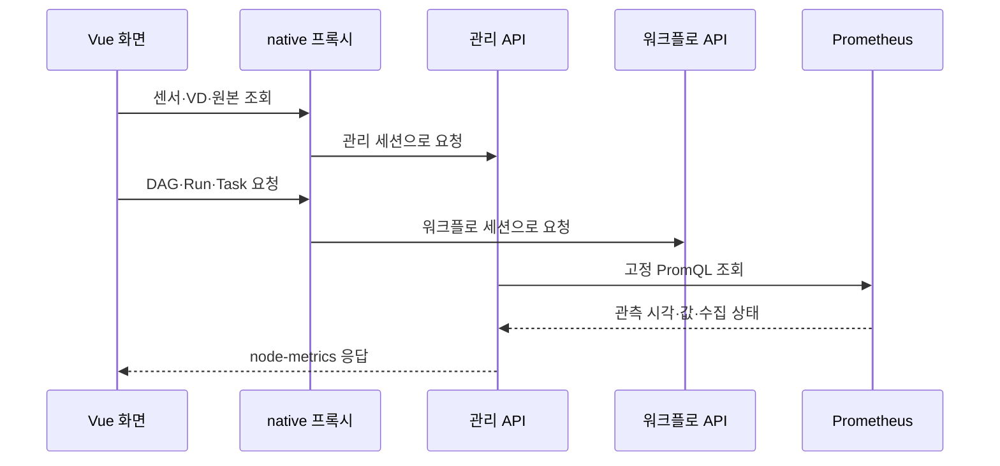

# Kestra 기반 엣지 자원 모니터링과 통합 운영 콘솔

**기술메모 TM-06** · 2026-10-20

과제명: (기입) · 작성자: (기입) · 검토자: (기입)
기준 소스: `1170c1e88667ea22bba2b21844456c18821e0213`

## 개요

EdgeAI의 센서·가상디바이스·실행 모듈·워크플로 관리 기능을 Kestra 원본 Vue UI에 연결했다. 노드와 가속기 상태, 작업 실행 결과, 감사 기록을 한 콘솔에서 확인한다. Kestra v2.0.6의 UI를 사용하며, 실행 제어는 기존 EdgeAI API가 담당한다. Kestra 서버와 DB는 설치하지 않는다. [1]

개발한 부분은 EdgeAI용 Vue 화면, 라우터와 API 연동, 독립 세션 처리, 메트릭 식별·집계, 이력 조회, 편집 상태 보존이다. Kestra 디자인 시스템과 ECharts, Prometheus는 기존 소프트웨어를 사용한다.

| 화면 | 기능 |
|---|---|
| 운영 현황·장치 | 서버 우선 목록, CPU·메모리·GPU·NPU, 센서 관리 |
| VD·저장소 | 계산·저장 정책, 원본·결과 그래프와 이력 |
| 모듈·워크플로 | SERVICE 버전, DAG 편집, 초안 저장, 파일 교환 |
| 실행·감사 | Run·Task·Result, STREAM 경로, 전환 이력, 감사 ID |

## 메트릭 수집과 표시

서버가 고정 PromQL로 기존 Prometheus를 조회하고 브라우저에는 API 응답을 전달한다. node-exporter, kube-state-metrics, 장비별 exporter의 값을 실제 Kubernetes 노드와 연결한다. DCGM의 `Hostname`이 exporter Pod 이름이면 Pod의 노드 배치를 확인해 연결한다. [2]

| 자원 | 계산·수집 기준 | 표시 방법 |
|---|---|---|
| CPU | idle 시계열의 최근 두 값으로 irate 계산 | 노드별 사용률 |
| 메모리 | MemAvailable과 MemTotal | 가용 메모리를 제외한 사용 비율 |
| GPU | DCGM·Jetson·Spark 지표 | 장치별 사용률과 제공되는 상세 정보 |
| NPU | exporter와 장착 정보 | 사용률 수집 여부를 함께 표시 |
| 노드 상태 | Ready 조건, 수집 시각, 수집 성공 여부 | Ready·NotReady·Unknown 구분 |

운영 표는 AI 서버부터 보여주고 더보기에서 엣지와 분류 미확인 노드까지 펼친다. CPU·메모리는 막대로, GPU·NPU는 같은 열에서 장치별로 표시한다. 실제 0과 미수집·만료를 구분하며, 공유 슬롯을 물리 GPU 여러 개로 세지 않는다. [1]

Intel NPU는 운영 표에서 숨기되 원본 지표는 유지한다. 더보기는 목록의 표시 범위만 바꾸며 KPI와 전체 상태의 범위는 유지한다. 화면을 자주 새로고침해도 exporter 수집 주기보다 빠른 새 값이 생기지는 않는다.

## API와 편집 상태 관리

관리 API와 워크플로 API는 지정된 서버 주소로 연결한다. 각각의 세션·CSRF를 유지하고 revision, `Idempotency-Key`, 감사 ID를 전달한다. lossless JSON으로 큰 정수를 보존하며 허용하지 않은 경로와 메서드의 쓰기를 막는다. [1]

| 구성 | 현재 로컬 포트 |
|---|---|
| Kestra 콘솔 개발 | 13083 |
| Kestra 콘솔 release | 13080 |
| 관리 API | 18080 |
| 워크플로 API | 18082 |

DAG 편집기는 그래프·코드·입력 선택·버전 발행을 연결한다. 초안은 워크플로별로 브라우저에 저장하고 사용자가 복구한다. 적용 전 JSON, 좌표, 큰 정수를 유지한다. 파일로 교체할 때는 현재 작업을 덮어쓸지 확인하며, 취소하거나 검증에 실패하면 기존 내용을 남긴다.

## 이력 자동 갱신

| 대상 | 갱신 주기·조건 | 유지할 상태 |
|---|---|---|
| 실행 목록·선택 상세 | 첫 페이지 3초, 선택 상세 자동 조회 | 선택한 Run·Task |
| STREAM 경로 | 펼친 첫 페이지 3초 | 접기·일시정지·과거 페이지에서는 중단 |
| 감사 목록 | 첫 페이지 5초 | 선택한 미확정 응답 |
| 센서·VD 이력 | 5초, 일시정지 지원 | 확대 구간과 과거 원본 표 |

초기·수동 조회는 로딩 상태를 표시한다. 백그라운드 갱신은 화면을 가리지 않는다. 조회에 실패하면 마지막 기록과 오류를 함께 보여주고, 대상을 바꾼 뒤 도착한 이전 응답은 버린다.

전환 이력에는 대상·진행 상태·실패 코드·판단 기준을 먼저 표시한다. checkpoint와 전체 JSON은 펼쳐서 확인한다. 새 Attempt가 없는 실패를 ‘대기 중’으로 표시하지 않는다.

## 화면 통합의 설계 범위

운영자는 장치 등록, 입력 데이터, 계산 정의와 실행 결과를 오가며 상태를 확인한다. 기존 기능을 Kestra 화면에 연결할 때는 화면의 식별자와 실행 서버의 식별자를 동일하게 유지하고, 관리 API와 워크플로 API의 인증 경계를 보존하는 것이 필요했다. 이를 위해 Kestra 원본 UI와 EdgeAI 화면을 연결하되 서버의 실행·저장 계약은 기존 API를 사용했다.

| 요구사항 | 구현에서 확인할 조건 | 근거 |
|---|---|---|
| R06-01 실제 관측과 미수집 구분 | 값 0, 누락, 만료, 조회 실패가 서로 다른 상태 | 메트릭 DTO·overview 시험 |
| R06-02 장비 식별 유지 | exporter 측정값을 실제 노드·물리 가속기와 연결 | Prometheus 매핑·공유 슬롯 시험 |
| R06-03 쓰기 계약 보존 | 대상별 세션·CSRF·revision·멱등 키 전달 | native API HTTP 시험 |
| R06-04 편집 상태 보존 | 큰 정수·DAG 연결·좌표 유지, 취소 시 원래 초안 유지 | 편집 파일·브라우저 시험 기록 |
| R06-05 조회 갱신 중 선택 유지 | 지연된 이전 응답이 새 선택을 덮어쓰지 않음 | 가상 시계·지연 HTTP 응답 시험 기록 |

개발 성과는 EdgeAI 기능을 위한 Vue 화면과 API 연동, 관측값 집계·표시, 편집과 이력 동작이다. Kestra 엔진, ECharts, Prometheus 또는 장비 exporter 자체를 새로 개발한 성과로 포함하지 않는다. 본 문서는 DDS를 개발 성과 범위에 포함하지 않는다.

## 화면에서 API까지의 요청 경로

[프록시 구현](../../dashboard/kestra-native/device-registration.ts)은 경로와 HTTP 메서드의 허용 목록을 사용한다. 전달 가능한 요청이라는 이유로 임의의 API 경로나 파일 경로를 통과시키지 않는다. JSON을 일반 JavaScript 숫자로 파싱한 뒤 다시 직렬화하면 `9007199254740993` 같은 정수가 바뀔 수 있으므로 정확한 숫자 표기를 보존하는 경로를 사용한다. 멱등 키가 필요한 요청을 재전송할 때도 원래 키를 유지해야 한다.

관리 서버와 워크플로 서버를 분리한 환경에서는 동일 브라우저에 두 세션이 존재할 수 있다. 워크플로 요청에 관리 세션을 잘못 보내면 로그인 또는 CSRF 실패가 발생한다. 따라서 프록시는 목적지에 맞는 세션만 전달한다. 쓰기 실패는 서버의 상태 코드와 오류 본문을 보존해 표시하고, 사용자가 입력한 설정을 성공으로 오인해 닫지 않게 한다.

## 관측값의 계산과 식별

CPU 사용률은 idle 비율을 제외한 값이며, 최근 두 수집값에 대한 `irate`를 사용한다. `[2m]`는 두 표본을 찾는 범위이지 2분 평균을 뜻하지 않는다. 메모리 사용률은 `100 × (1 - MemAvailable / MemTotal)`로 해석한다. GPU gauge와 Intel NPU의 rate는 수집 의미가 다르므로 같은 주기로 화면을 갱신해도 같은 시간 해상도로 측정된 값이 되지는 않는다.

장비별 시계열을 연결할 때는 이름이 비슷하다는 이유만으로 노드를 배정하지 않는다. DCGM의 `Hostname`이 Pod 이름인 경우에는 `kube_pod_info`의 실제 배치를 사용한다. PCI 주소가 있으면 정규화한 주소로 연결하고, 주소가 없는 exporter는 같은 노드·종류·벤더의 후보가 각각 하나일 때만 연결한다. 모호한 시계열은 `unmappedSeries` 등으로 드러내고 임의의 장치 수에 합치지 않는다.

| 입력 상태 | 화면과 집계에서의 처리 | 잘못된 해석을 막는 이유 |
|---|---|---|
| fresh이고 값이 0 | 정상 0으로 표시 | 유휴 장비를 고장이나 미수집으로 보지 않음 |
| 장착 정보만 fresh | 장치 표시, 사용률 미수집 표시 | 장착 여부와 부하 측정 여부를 구분 |
| 사용률 원본이 90초 초과 | 만료 상태, 숫자를 최신값처럼 표시하지 않음 | 오래된 부하로 현재 배치를 판단하지 않음 |
| exporter 실패·부분 경고·조회 실패 | 수집 불가 상태를 표시 | 마지막 성공 응답을 현재 성공으로 재사용하지 않음 |
| allocatable에 공유 슬롯 여러 개 | 물리 장비 수와 별도로 해석 | 논리 자원 슬롯을 GPU 여러 대로 부풀리지 않음 |

[NodeMetricsResponse](../../backend/app/src/main/java/io/edgeai/app/dto/NodeMetricsResponse.java)는 응답 전체의 `fetchedAt`과 개별 측정값의 `observedAt`, `fresh`를 따로 제공한다. 화면 조회 시각만 갱신됐다고 원본 관측 시각도 새로워진 것은 아니다. 응답 `status`는 AVAILABLE·DISABLED·UNAVAILABLE로 구분한다. 백엔드는 동시 조회 결과를 5초 동안 공유한다. 상세 매핑과 기본 만료 기준은 [노드 메트릭 가이드](../guides/node-metrics.md)에 있다.

## 비동기 조회와 편집 파일의 일관성

사용자가 A 실행을 선택한 상태에서 상세 조회가 시작되고, 응답 전에 B 실행을 선택할 수 있다. A의 늦은 응답이 도착해도 현재 선택 B의 상세 영역에 넣지 않아야 한다. Run·Task·이력 대상의 식별자와 조회 세대를 기준으로 응답을 구분하고, 페이지 이탈이나 선택 변경 후의 응답을 버린다. 조회 시작 때 선택 상태를 무조건 초기화하면 자동 갱신마다 상세가 닫히므로 기존 선택과 화면 확대 범위를 유지한다.

초기 조회는 데이터가 없는 상태, 조회 실패는 데이터를 얻지 못한 상태, 성공한 빈 목록은 대상이 없는 상태다. 이 세 상태를 같은 빈 표로 표시하지 않는다. 백그라운드 갱신에 실패하면 마지막 데이터와 오류를 함께 남겨 사용자가 정보의 신뢰도를 판단할 수 있게 한다. 과거 페이지를 보는 중에는 새 데이터가 들어와도 첫 페이지로 되돌리지 않는다.

편집 파일은 `edgeai.workflow-editor/v1` 형식으로 DAG와 좌표를 함께 보관한다. 파일을 읽었다고 즉시 서버 버전으로 발행하지 않는다. 파일 검사, 덮어쓰기 확인과 편집기 적용, 서버 발행은 별도 단계다. 취소·잘못된 모듈 참조·크기 초과 때는 기존 편집 내용을 유지한다. 브라우저 로컬 초안은 해당 브라우저의 복구 수단이며 서버의 공동 편집 저장소나 발행 버전 보관소를 대신하지 않는다.

## 시험 결과

| 시험 | 확인한 내용 | 방식 |
|---|---|---|
| 메트릭 | 실제 0·만료·누락, 장착 정보, 공유 슬롯 | API 단위 시험 |
| 프록시 | 독립 세션, CSRF, 큰 정수, 멱등 키, 경로 제한 | HTTP 시험 |
| 파일 교체 | 취소, 같은 파일 재선택, 오류 시 유지, 좌표·큰 정수 보존 | 2026-10-19 브라우저 시험 |
| 이력 갱신 | 선택 유지, 과거 페이지, 일시정지, 실패 후 복구 | 가상 시계·HTTP fixture |
| STREAM·전환 | 세대·차단 사유, 지연 응답 격리, 정책 없는 기록 | 2026-10-20 브라우저 시험 |

2026-10-20 Vue 타입 검사, native API 시험 27개, 문서 검사가 통과했다. 전환 종료 상태 오표시와 정책 요약 누락을 수정한 뒤 Standards·Spec 재검토의 남은 지적은 각각 0건이었다. 모바일은 메뉴를 접은 390px 화면에서 확인했다. [3]

실제 API에서는 Run 6개·Task 12개·저장 경로 6개를 읽었다. 해당 작업에 전환 이력이 없어 전환 화면의 상태 변화는 fixture로 확인했다.

### 대표 회귀 시험의 입력과 판정

| 시험 ID | 입력·조치 | 기대 결과 | 시험 근거 |
|---|---|---|---|
| TC06-01 | 쓰기 JSON에 `9007199254740993`, revision과 멱등 키 전달 | upstream까지 JSON 숫자·헤더 그대로 전달 | `kestra-console.unit.mjs` |
| TC06-02 | 관리·워크플로 세션을 동시에 가진 요청 | 목적지별 세션만 전달 | 같은 파일의 independent sessions 시험 |
| TC06-03 | 허용하지 않은 경로·메서드, 다른 origin으로 쓰기 요청 | upstream 쓰기 없이 거절 | 콘솔·등록 HTTP 경계 시험 |
| TC06-04 | GPU 사용률 0, 메모리 누락, 공유 슬롯, 미수집 NPU | 0·누락·장착·물리 대수 구분 | `kestra-overview.unit.mjs` |
| TC06-05 | 자동 조회 중 선택 변경·과거 페이지·일시정지 | 이전 응답 격리, 사용자가 보는 상태 유지 | 2026-10-19·20 브라우저 기록 [3] |

단위 HTTP 시험은 임시 로컬 upstream을 사용해 경계 동작을 확인한다. 해당 시험에 모든 외부 서버·실제 장치가 연결되는 것은 아니다. 2026-10-20의 실제 API 읽기 확인도 저장된 경로 조회 범위이며, 없었던 전환 이력을 새로 만들거나 실제 전환을 수행한 시험은 아니다. 시험 소스는 [콘솔](../../dashboard/tests/kestra-console.unit.mjs), [센서 등록](../../dashboard/tests/kestra-device-registration.unit.mjs), [운영 현황](../../dashboard/tests/kestra-overview.unit.mjs)에 있다.

이번 문서 개정에서도 위 native API 경계 suite 27개를 다시 실행해 모두 통과했다. 당시 브라우저 시험 기록과 달리 이번 재실행 범위는 로컬 HTTP 경계이며 운영 콘솔의 전환 동작을 새로 실증한 것은 아니다.

## 실행 환경과 남은 작업

`dashboard/kestra-native/`에 Vue 화면과 API 연동 코드가 있다. `scripts/dev/dev-kestra-native.sh`는 Kestra v2.0.6 원본 revision `b59444f09be2e44a3b0738452b2e02fc4fe89505`를 준비하고 Node 24·npm 11로 실행한다. [1][5]

현재는 기존 웹과 API를 유지한 채 별도 포트로 실행한다. 기본 포트 통합과 자동 시작은 별도 작업이다. 전체 과거 UI의 기능 비교, 사용자별 인증·권한, 장기 운영 검증도 남아 있다. 설치와 시험 절차는 [TDP-02](TDP-02_워크플로_실행과_통합_운영.md)를 참고한다.

## 참고 자료

1. [Kestra 콘솔과 로컬 실행](../guides/local-development.md)
2. [노드·가속기 메트릭](../guides/node-metrics.md)
3. [구현·시험 기록](../../PROGRESS.md)
4. [남은 개발·검증 항목](../../PLAN.md)
5. [원본 UI 준비 스크립트](../../scripts/dev/dev-kestra-native.sh)
6. [실행 화면 구현](../../dashboard/kestra-native/RunsPage.vue)
