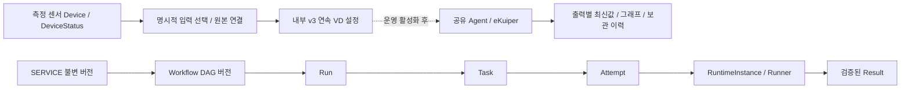

# 원 설계와 현재 구현 대조

원본 센서·실행 모듈·계산 설정·실행 인스턴스의 신원을 구분합니다. 현재 센서는 측정 항목별 CRD, 가상 센서는 중앙 eKuiper 연속 계산, 일반 서비스는 SERVICE DAG를 사용합니다. 구형 VD supervisor와 공개 VD 템플릿은 종료됐습니다.

## 현재 리소스 흐름

센서나 SERVICE를 등록하는 작업이 가상 센서를 자동 생성하지 않습니다. 연속 VD 하나에 여러 입력·출력을 등록할 수 있으며 출력 CRD는 생성하지 않습니다. HTTP Virtual 센서 입력과 연속 VD 계산도 다른 리소스입니다.

## 화면·API 연결

| 원칙 | 현재 연결 | 구현과 조건 |
|---|---|---|
| 센서와 실행 모듈 분리 | 센서 화면 / 실행 모듈 관리 | 센서는 CRD·프로토콜별 저장 규격, SERVICE는 불변 실행 버전 |
| 측정 항목별 신원 | Device·DeviceStatus와 센서 행 | 물리 연결은 공유할 수 있지만 측정 센서는 각각 표시 |
| 명시적 VD 입력·계산 | 가상 장치 등록 모달·연속 API | v3 설정·revision·원본 UID/모델·별칭·유효 시간 |
| 공유 계산 엔진 | 중앙 processing Agent/eKuiper | VD별 SERVICE·supervisor·Pod 없음; 운영 활성화 별도 |
| 계산 출력 구분 | 가상 센서 결과 행·그래프 | 출력별 시각·quality·generation·저장 누락 확인 |
| 일반 서비스 실행 | SERVICE → WorkflowVersion → Run → Task/Attempt | AUTO/NODE/REMOTE, 구형 VD 실행 정책은 미제공 |
| kube-scheduler 최종 bind | 자원·아키텍처·명시적 affinity·Placement | 일반 nodeName 우회 없이 실제 배치 확인 |
| 결과 검증 후 확정 | Task Result와 고정 객체 버전 | Pod/Operation 완료를 검증된 Result로 바꾸지 않음 |
| 등록 작업의 독립 화면 | 센서·VD·모듈·Workflow·DAG 모달 | 배경 고정·모달 본문 스크롤·실패 입력 유지·포커스 복귀 |

## 현재 운영과 남은 수용

연속 flag는 기본 false입니다. 실제 센서용 NanoMQ와 중앙 eKuiper 설치는 운영 Agent·qualified 입력·history 연결의 완료 증거가 아닙니다. 센서 최신값과 MQTT 원본 장기 저장, 계산 출력 보관 이력은 다른 기능입니다.

| 항목 | 다음 확인 |
|---|---|
| 센서 → 중앙 연속 계산 | qualified observation·신원·설정·세션 순서, Agent·TLS·history 배포, 엔진 lease·결과 수용 |
| 새 입력 프로토콜 | Mapper가 공통 관측 계약으로 정규화; MQTT 입력뿐 아니라 지원 수집 프로토콜을 사용 |
| 운영 연속성 | 실제 24시간 soak·저장 누락·재시작·손실/중복·용량·되돌리기 |
| 원본 MQTT 이력 | 영속 consumer·outbox·재전송과 일반 STREAM 자동 연결은 별도 잔여 범위 |
| 외부 Remote·GPU/NPU·실모델 | 참조 구현과 실장비·실모델·외부 계약 수용을 구분 |
| identity/RBAC·성능·종합 복구 | 사용자별 권한·합의 기준·전체 재가동 수용은 미완료 |

현재 배포와 다음 순서는 [현재 상태](../../PROGRESS.md), [개발 단계](../../PLAN.md)를 확인합니다. 사용법은 [센서 등록](../guides/sensor-registration.md), [연속 계산](../guides/vd-processing.md), [DAG 실행](../guides/dag-execution.md), [DDS 배포](../guides/workflow-editor-integration.md)를 따릅니다. 구형 데이터 정리와 호환 이력의 경계는 [제거 결정](../adr/0115-retire-legacy-virtual-devices.md)을 확인합니다.
