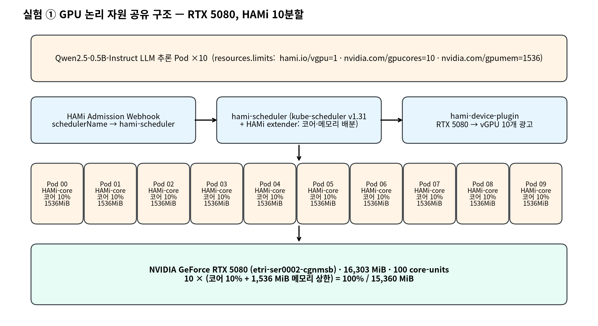
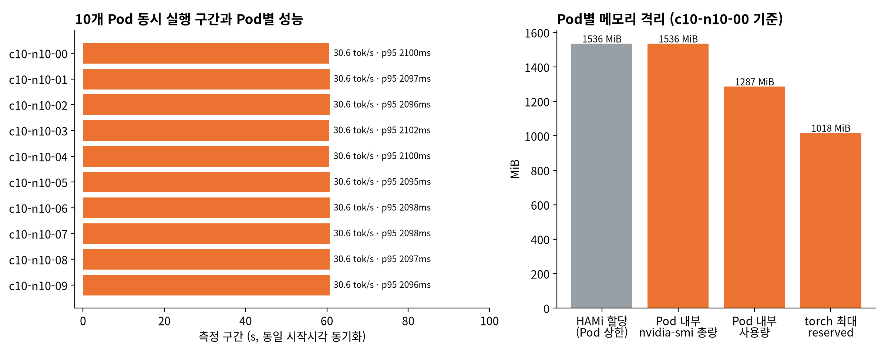
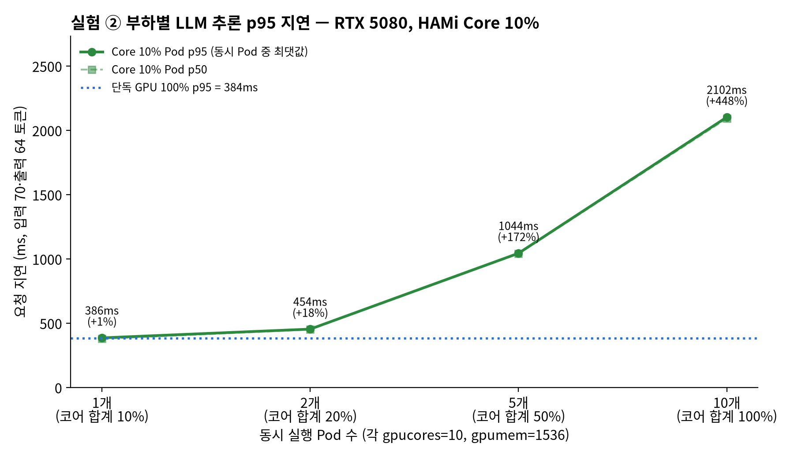
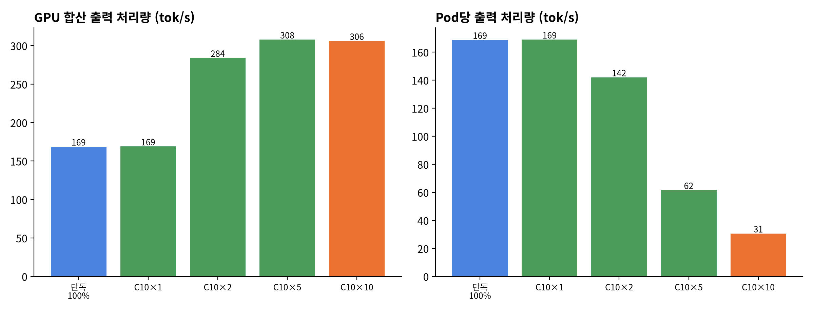
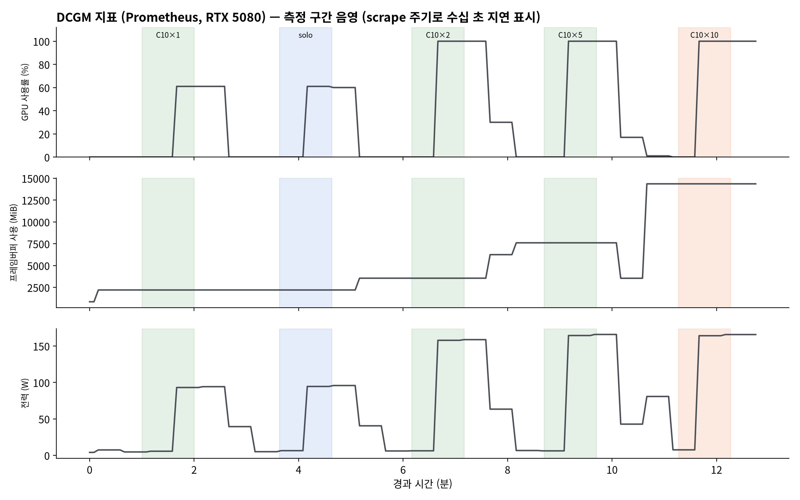

# HAMi GPU 공유 실험 — RTX 5080 LLM 추론 (2026-10-28)

HAMi로 GPU 1개를 여러 Pod에 논리적으로 나눌 때 할당이 지켜지는지(실험 ①)와 동시 Pod 수에 따라 추론 지연이 얼마나 늘어나는지(실험 ②)를 기록합니다.
일회성 측정 기록이며 플랫폼 기능 문서나 KPI 수용 근거가 아닙니다.

## 환경

| 항목 | 값 |
|---|---|
| 노드 / GPU | `etri-ser0002-cgnmsb` / NVIDIA GeForce RTX 5080 16,303 MiB, 드라이버 595.99.02 |
| HAMi | v2.10.0 (hami-core), [hami-values.yaml](hami-values.yaml). 기존 nvidia-device-plugin과 겹치지 않게 vGPU 리소스 이름을 `hami.io/vgpu`로 분리하고 대상 노드·webhook 네임스페이스를 한정 |
| 모델 | Qwen2.5-0.5B-Instruct, FP16, transformers 4.56.2, `generate` 탐욕 디코딩 |
| 요청 | 입력 70 토큰(한국어 질문 1개), 출력 64 토큰 고정, 요청을 순차 반복 |
| 이미지 | `pytorch/pytorch:2.8.0-cuda12.8-cudnn9-runtime` |
| 측정 | Pod마다 60초, 모든 Pod가 같은 시각에 측정 시작, 조건별 1회 |

조건: 단독(gpucores=100, 메모리 제한 없음), Core 10%(gpucores=10, gpumem=1536) Pod 1·2·5·10개 동시 실행.
Pod 10개 조건이 실험 ①의 10분할입니다.

## 결과

| 조건 | Pod | p50 ms | p95 ms | 단독 대비 p95 | Pod당 tok/s | 합산 tok/s | Pod 내 메모리 사용/총량 |
|---|---|---|---|---|---|---|---|
| 단독 GPU 100% | 1 | 378.7 | 383.7 | — | 168.7 | 168.7 | 1287 / 16303 MiB |
| Core 10% × 1 | 1 | 377.9 | 385.7 | +1% | 168.9 | 168.9 | 1287 / 1536 MiB |
| Core 10% × 2 | 2 | 450.4 | 453.8 | +18% | 142.0 | 284.0 | 1287 / 1536 MiB |
| Core 10% × 5 | 5 | 1040.2 | 1043.6 | +172% | 61.6 | 307.8 | 1287 / 1536 MiB |
| Core 10% × 10 | 10 | 2091.4 | 2101.9 | +448% | 30.6 | 306.0 | 1287 / 1536 MiB |

p50·p95는 동시 Pod 중 최댓값, 원본은 [results/](results/)의 Pod별 JSONL입니다.

### 실험 ① GPU 논리 자원 공유 (10분할)




- Pod 10개가 같은 GPU UUID에 `1536 MiB, 코어 10`으로 배정됐습니다([Pod 어노테이션](results/c10-n10-pod00-annotations.json)).
- 10개가 같은 60초 구간에 함께 실행됐고 Pod 간 p95 차이는 7.1ms(2094.8~2101.9ms)입니다.
- Pod 안의 `nvidia-smi`에는 총 메모리가 1536MiB로 보이고(사용 1287MiB), 호스트에는 14,364/16,303MiB가 보입니다([Pod](results/c10-n10-nvidia-smi-in-pod.txt), [호스트](results/c10-n10-nvidia-smi-host.txt)).

### 실험 ② 부하별 성능




- Core 10% Pod가 혼자 실행될 때는 단독 100%와 성능이 같았습니다. 경쟁하는 Pod가 없으면 코어 상한이 지연에 나타나지 않았습니다. HAMi-core 기본 사용률 정책의 동작으로 보이며, 항상 상한을 두는 `GPU_CORE_UTILIZATION_POLICY=force`는 시험하지 않았습니다.
- 동시 Pod가 늘면 GPU를 나눠 쓰므로 Pod당 처리량이 줄고 지연이 늘었습니다. 2개에서는 p95 +18%, Pod당 처리량 −16%입니다.
- 합산 처리량은 2개에서 284 tok/s, 5개 이상에서 약 306~308 tok/s로 포화됐습니다. 단일 요청 스트림은 GPU를 다 채우지 못해(DCGM 사용률 약 60%) 단독보다 합산 처리량이 약 1.8배 높습니다.
- 운영 판단: 이 모델·요청 조건에서 p95를 단독 대비 +20% 안쪽으로 두려면 GPU당 동시 2개 정도가 한계이고, 10분할은 메모리 격리는 지켜지지만 요청 지연이 약 5.5배가 됩니다.

### DCGM



Grafana 캡처: [전체 구간](figures/grafana-dcgm-all.png), [10분할 구간](figures/grafana-dcgm-exp1-10split.png).
Prometheus 수집 주기 때문에 DCGM 그래프는 측정 구간보다 수십 초 늦게 나타납니다. 마지막 구간 뒤의 평탄한 값은 수집 공백 구간입니다.

## 한계

- 조건별 1회, 60초 측정이며 반복·신뢰구간이 없습니다.
- 요청은 Pod 안에서 순차 실행한 고정 길이 요청이며, 서빙 엔진(vLLM 등)·배치·네트워크 경로는 포함하지 않습니다.
- Core 10% 단독 조건에서 상한이 적용되지 않은 원인은 HAMi 정책 설정으로 따로 확인하지 않았습니다.

## 재현

```bash
# HAMi 설치 (대상 노드 라벨 후)
kubectl label node etri-ser0002-cgnmsb hami.io/vgpu-node=on
helm repo add hami-charts https://project-hami.github.io/HAMi/
helm install hami hami-charts/hami --version 2.10.0 -n hami-system --create-namespace -f hami-values.yaml

# 모델과 transformers를 노드의 /var/tmp/hami-bench에 준비 (llm-prep Pod, 아래 명령과 같은 내용)
#   pip install --target /cache/pylib transformers==4.56.2
#   huggingface_hub.snapshot_download('Qwen/Qwen2.5-0.5B-Instruct', local_dir='/cache/models/Qwen2.5-0.5B-Instruct')

scripts/run.sh solo 1 100 0          # <이름> <Pod 수> <gpucores> <gpumem MiB, 0=제한 없음>
for n in 1 2 5 10; do scripts/run.sh c10-n$n $n 10 1536; done
python scripts/figs.py               # matplotlib, Noto Sans CJK, Prometheus 접근 필요
```

## 정리

```bash
helm -n hami-system uninstall hami
kubectl delete ns hami-bench hami-system
kubectl label node etri-ser0002-cgnmsb hami.io/vgpu-node-
# 노드의 /var/tmp/hami-bench(모델·패키지 약 1.1GB) 삭제
```
