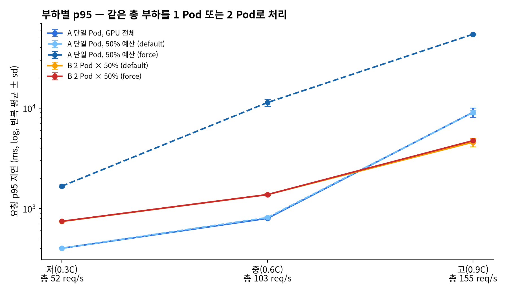
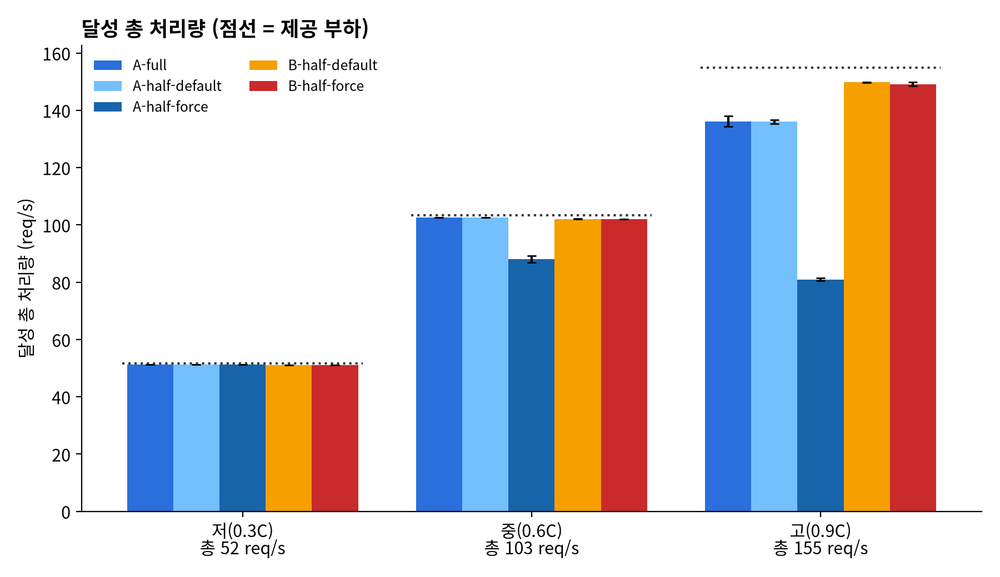
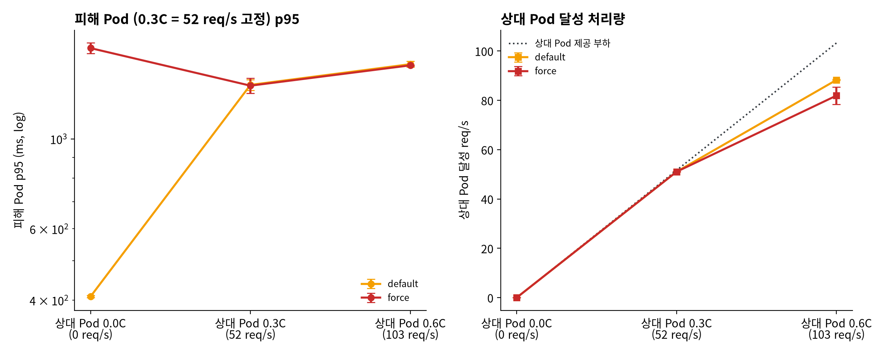
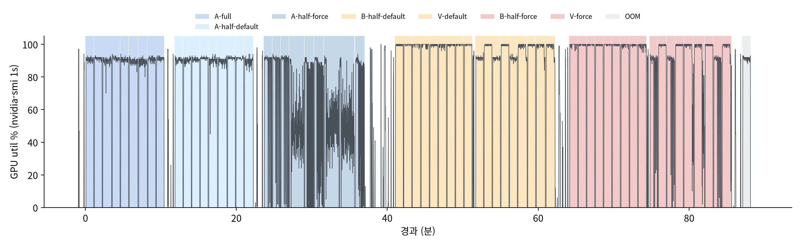

# HAMi GPU 공유 — 처리량·지연·간섭 측정 (RTX 5080, 2026-10-29)

질문: 하나의 GPU를 여러 추론 작업이 공유할 때 전체 처리량은 얼마나 확보되고, 작업별 지연과 성능 간섭은 얼마나 생기는가?

HAMi의 논리 Core 비율(`gpucores`)은 물리 연산 성능 보장 비율로 취급하지 않고, 실제 지연·처리량으로 확인합니다.
실장비 측정 기록이며 플랫폼 기능 문서나 KPI 수용 근거가 아닙니다.

## 환경

| 항목 | 값 |
|---|---|
| 노드 / GPU | `etri-ser0002-cgnmsb` / RTX 5080 16,303 MiB, 드라이버 595.99.02 |
| HAMi | v2.10.0, [hami-values.yaml](../hami-gpu-sharing-20261028/hami-values.yaml) (10/28 실험과 동일) |
| 서빙 | vLLM 0.11.0 (`vllm/vllm-openai:v0.11.0`), Qwen2.5-1.5B-Instruct BF16, `max-model-len 2048` |
| 요청 | 입력 70 토큰 · 출력 64 토큰 고정(`--ignore-eos`), Poisson 도착(`vllm bench serve --request-rate`) |
| 측정 | 측정 구간 60초, 조건별 3회, 같은 서버 구성 안에서 부하·반복 순서 무작위 |
| GPU 지표 | nvidia-smi 1초 간격(물리 GPU), HAMi Pod별 지표(`hami_container_device_utilization_ratio`, `hami_vgpu_memory_used_bytes`) 1초 간격 |
| 동시 사용 | 운영 Pod `edgeai-scenario-gpu`가 GPU 메모리 약 0.85 GiB를 점유(연산 0%) |

C는 GPU 전체를 쓰는 서버 1개에 요청 6,000건을 한꺼번에 보냈을 때의 처리량(3회 중 최솟값)인 **172.1 req/s**입니다([capacity.json](results/capacity.json)).
부하는 저 0.3C(52 req/s), 중 0.6C(103), 고 0.9C(155)이며, 두 Pod 조건에서는 같은 총 부하를 반씩 나눕니다.

| ID | 구성 | 목적 |
|---|---|---|
| A-full | Pod 1, `gpucores=100`, 메모리 제한 없음 | 물리 GPU 전체 기준 |
| A-half-default / A-half-force | Pod 1, `gpucores=50`, `gpumem=7680` | 50% 예산 단독, 정책별 |
| B-half-default / B-half-force | Pod 2 × (50, 7680) | 같은 총예산·같은 총 부하를 두 Pod로 |
| V-default / V-force | Pod 2 × (50, 7680), 피해 Pod 0.3C 고정, 상대 Pod 0 / 0.3C / 0.6C | 성능 간섭 |
| OOM | 50% 서버(0.3C) + `gpumem=2048` Pod의 초과 할당 | 메모리 상한·오류 형태·이웃 영향 |

정책은 Pod 환경변수 `GPU_CORE_UTILIZATION_POLICY`(default / force)로 지정했습니다.

## 결과

전체 표는 [results/summary.md](results/summary.md)입니다. 원본은 [results/runs.jsonl](results/runs.jsonl)(측정 1회당 1줄, 1초 표본 포함)과 [results/gpu-mon.log](results/gpu-mon.log)입니다.
63회 측정과 OOM 시험 모두에서 요청 실패 0건, 서버 재시작 0회였습니다.

### 1. 같은 총 부하: Pod 1개 vs 2개

| 총 부하 | A-full p95 | B-half p95 (default / force) | A-full 처리량 | B-half 합산 처리량 |
|---|---|---|---|---|
| 저 52 req/s | 403 ms | 738 / 740 ms (**×1.8**) | 51.3 | 51.1 |
| 중 103 req/s | 799 ms | 1,372 / 1,376 ms (**×1.7**) | 102.6 | 102.1 |
| 고 155 req/s (과부하) | 9,090 ms | 4,543 / 4,725 ms (×0.5) | 136.1 | 149.8 (**+10%**) |




- 처리 능력 안쪽(저·중)에서는 GPU를 두 Pod로 나누면 처리량은 같고 p95가 1.7~1.8배가 됩니다. vLLM 엔진 1개는 모든 요청을 한 배치로 묶지만, 엔진 2개는 GPU를 시간 단위로 번갈아 쓰기 때문으로 보입니다. HAMi Pod별 사용률이 각각 약 47~50%입니다.
- 과부하(0.9C)에서는 두 Pod의 합산 처리량이 10% 높고 p95도 낮았습니다. 단일 엔진은 CPU 스케줄 루프가 1코어를 채워 GPU 사용률이 87%에 머물렀고, 두 엔진은 97%까지 올라갑니다.
- 0.9C는 실제로 과부하입니다. 요청이 Poisson으로 들어오면 GPU 전체로도 약 136 req/s만 지속 처리합니다. 요청을 한꺼번에 보내 측정한 C가 지속 가능 처리량을 약 20% 높게 잡습니다.

### 2. Core 정책: default는 상한이 없고, force는 상한을 지키지만 여유 GPU도 쓰지 못함

| 조건 (Pod 1개, 50% 예산) | 저 p95 | 중 p95 | 고 p95 | 고부하 처리량 | HAMi Pod 사용률 (저) |
|---|---|---|---|---|---|
| A-full (비교) | 403 ms | 799 ms | 9,090 ms | 136.1 | 89% |
| A-half-default | 403 ms | 814 ms | 9,052 ms | 136.0 | 89% |
| A-half-force | 1,672 ms (×4.1) | 11,370 ms | 54,466 ms | 81.0 (C의 47%) | 80% |

- default에서는 `gpucores=50`이 성능에 나타나지 않았습니다. 다른 Pod와 경쟁할 때도 제한하지 않습니다(10/28 실험의 Core 10% × 2·5 결과와 같음).
- force에서는 처리량이 C의 약 47%로 묶입니다. 이웃이 없는 저부하에서도 p95가 4.1배가 됩니다.
- force에서 HAMi가 보고한 Pod 사용률은 80%입니다. 논리 Core 50%는 성능 50%와도, 사용률 지표 50%와도 같지 않습니다.
- 두 Pod가 모두 바쁠 때는 default와 force의 결과가 같습니다(B, V-a-mid). 이미 두 Pod가 GPU를 반씩 쓰고 있기 때문입니다.

### 3. 성능 간섭 (피해 Pod 0.3C 고정)

| 상대 Pod 부하 | default 피해 p95 | force 피해 p95 | 상대 Pod 달성 처리량 (default / force) |
|---|---|---|---|
| 0 (유휴) | 408 ms | 1,674 ms | — |
| 0.3C (자기 예산 안) | 1,359 ms (**+233%**) | 1,353 ms | 51.1 / 51.1 |
| 0.6C (예산 초과 과부하) | 1,528 ms (**+275%**) | 1,518 ms | 88.0 / 82.0 (상대 Pod p95 14.5 s / 17.1 s) |



- 상대 Pod가 자기 예산 안에서 일하기만 해도 피해 Pod p95가 3.3배가 됩니다. 두 정책 모두 이 간섭을 줄이지 못했습니다.
- 상대 Pod가 예산을 넘겨 과부하가 되어도, 상대 Pod가 예산 안일 때보다 피해 Pod p95가 12%만 더 늘었습니다. 과부하가 상대 Pod 쪽 대기열에 쌓이고, 시간 분할이 각 Pod에 약 절반씩 배분되기 때문입니다(HAMi Pod 사용률 40/55%).
- force의 피해 Pod는 상대가 유휴일 때(1,674 ms)보다 상대가 일할 때(1,353 ms) 더 빨랐습니다. HAMi-core force 제한기의 동작으로 보이지만 원인은 확인하지 않았습니다.

### 4. 메모리와 오류·OOM

- `gpumem=2048` Pod가 128 MiB씩 할당을 늘리다가 텐서 1,664 MiB에서 `CUDA out of memory`가 발생했습니다. Pod 안에서 보이는 총량은 2.00 GiB이고, HAMi 로그는 `Device 0 OOM 2151677952 / 2147483648`입니다([oom.json](results/oom.json)).
- 같은 GPU의 서버(0.3C)는 이 구간에 p95 400 ms, 실패 0건, 재시작 0회였습니다.
- HAMi는 다른 경로로 GPU를 쓰는 프로세스의 메모리를 예산에 넣지 않습니다. 운영 Pod가 0.85 GiB를 쓰는 상태에서 7,680 MiB Pod 2개(합계 15,360 MiB)를 모두 `gpu-memory-utilization 0.85`로 띄우자, 두 번째 서버가 기동 중 `cuMemoryAllocate failed res=2`로 실패했습니다([run.log](results/run.log)). 2-Pod 조건은 0.75로 낮춰 진행했습니다.
- nvidia-smi GPU 사용률은 저부하에서도 88%입니다. 부하 지표로 쓰기 어렵고, 전력(단일 Pod 205 W, 두 Pod 266 W)이 차이를 더 잘 보여 줍니다.



## 운영 판단

- 지연 목표가 있는 서비스는 GPU를 HAMi로 쪼개기보다 하나의 서빙 엔진에 요청을 모으는 편이 같은 GPU에서 p95가 절반 수준입니다.
- HAMi 공유의 이점은 메모리 격리와, 과부하·이질 작업에서 합산 처리량이 조금 늘어나는 정도입니다. 이웃에 대한 지연 격리는 default·force 모두 제공하지 않습니다.
- force는 상한을 지키는 대신 유휴 GPU를 쓰지 못합니다. 과금·공정성 목적에는 맞지만 지연 보장 수단은 아닙니다.
- 공유 노드에서는 HAMi 외부 GPU 사용량을 빼고 메모리 예산을 잡아야 합니다.

## 한계

- 모델 1종(1.5B), 고정 길이 요청, 측정 구간 60초, 조건별 3회입니다. 큰 모델·긴 출력·이질 작업 조합은 측정하지 않았습니다.
- 부하 생성기가 같은 노드에서 돌아 서버와 CPU를 공유합니다.
- A-full은 HAMi `gpucores=100` 경로입니다. `nvidia.com/gpu` 전용 할당은 운영 Pod가 쓰고 있어 비교하지 못했습니다.
- 2-Pod 조건은 `gpu-memory-utilization 0.75`, 단일 Pod 조건은 0.85입니다(0.85일 때 50% 예산 KV 캐시 2.96 GiB). 이 요청 길이에서는 동시 요청 수(최대 256)에 필요한 KV가 약 34k 토큰이어서 한계가 되지 않습니다.
- dcgm-exporter 값은 약 30초 주기로 갱신되고 `SM_ACTIVE`가 없어서 1초 해석에는 nvidia-smi와 HAMi 지표를 썼습니다.
- 0.5B 모델로 먼저 확인했을 때 엔진 CPU가 병목이어서(GPU 사용률 70~90%) 1.5B로 바꿨습니다. 1.5B에서도 단일 엔진 포화 시 엔진 프로세스 CPU가 1코어를 채웁니다.

## 재현

```bash
kubectl label node etri-ser0002-cgnmsb hami.io/vgpu-node=on
helm install hami hami-charts/hami --version 2.10.0 -n hami-system --create-namespace -f ../hami-gpu-sharing-20261028/hami-values.yaml
kubectl create ns hami-bench && kubectl label ns hami-bench hami.io/webhook=enabled
# 노드 /var/tmp/hami-bench/models/Qwen2.5-1.5B-Instruct 준비 (huggingface_hub.snapshot_download)
kubectl apply -f scripts/gpu-mon.yaml
python3 scripts/run.py capacity && python3 scripts/run.py matrix && python3 scripts/run.py oom
kubectl -n hami-bench logs gpu-mon > results/gpu-mon.log
uv run --with matplotlib python scripts/analyze.py
```

`scripts/preflight.yaml`은 vLLM이 sm_120·HAMi 상한에서 기동하는지 본 사전 점검입니다.

## 정리 (완료)

HAMi 제거, `hami-bench`·`hami-system` 네임스페이스 삭제, 노드 라벨 해제, 노드 `/var/tmp/hami-bench`(모델) 삭제를 마쳤습니다.
노드의 containerd에는 `vllm/vllm-openai:v0.11.0` 이미지(12.5 GB)가 남아 있습니다. 지우려면 노드에서 `crictl rmi docker.io/vllm/vllm-openai:v0.11.0`을 실행합니다.
